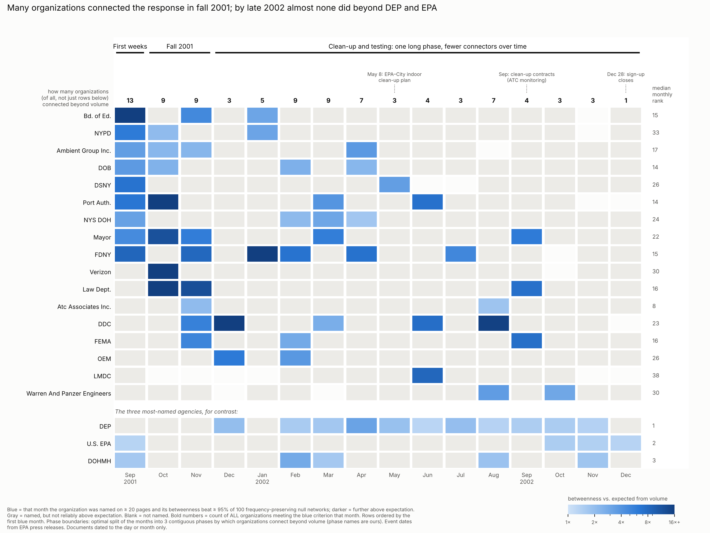

# After the Dust:  New York City's 9/11 records

## Networks, testing and the language usage


In September 2026, New York City released the records of its environmental response to 9/11: air tests, lab reports, inspections, contracts and internal memos, many of them sought by survivors and first responders for almost 25 years. We turned the release into a clean, linked dataset of 64,385 documents and 230,888 pages, so the archive can be read as a whole rather than one document at a time.

## Why this project

The release came after years of demands from first responders, elected officials and families, and with the settlement of two lawsuits brought by the advocacy group 9/11 Health Watch.[^1] It includes the "68 boxes" of Department of Environmental Protection files.[^1] It also came at a time when more people had died from 9/11-related illnesses than were killed on the day itself.[^3]

News coverage has focused on single documents, such as the Harding memo on possible lawsuits against the City.[^2] But the central questions about the response can't be answered from any one document:
* **Who held the response together?** Which organizations connected the different parts of the response, and when did that change? (RQ1)
* **Where did testing go?** Which buildings were tested, and how soon? (RQ2)
* **What were officials worried about?** Did internal language about risk and liability move ahead of what the public was told? (RQ3)

Answering them takes the whole archive, cleaned and linked. Reading it as data also shows its limits: whose files were released, and who is missing from them.

## Research questions

| | Question | Main finding | Status |
| --- | --- | --- | --- |
| **RQ1** Network | How were organizations positioned relative to each other in the response, and how did that change over time? | The organizations that look central are mostly the ones with the most paperwork. Holding that volume fixed, coordinators such as the Port Authority, the Mayor's Office and FDNY connected the response: many organizations did so in fall 2001, very few in 2002, and advocacy groups were barely tied in at all. | **Done**: [report](docs/02.network_analysis_report.md) |
| **RQ2** Spatial equity | How were Lower Manhattan buildings and blocks prioritized for testing? | Not yet: tests whether commercial hubs were tested earlier than residential zones. | In progress: `src/analysis/spatial/` |
| **RQ3** Language | How did administrative "liability anxiety" evolve compared with public messaging? | Not yet: tests whether liability and risk terms rose in internal memos weeks before public guidance changed. | In progress: `src/analysis/topics/` |

## Key findings so far

**The archive (ingestion and processing)**
* **Our copy is complete.** It holds 64,385 documents and 230,888 pages. Every page has the PDF's own text, and our counts match the site's own totals.
* **The archive is mostly two agencies' files.** By documents, 52% belong to the Department of Education (mostly one-page school air samples). By pages, 74% belong to DEP. Every archive-wide count is first a count over these two agencies' files.
* **The site's dates create false history.** The site dates each document by the earliest date anywhere in its text, which is often a lab-method date printed on every sheet. Checking dates against document titles fills in 6,638 missing dates, replaces 2,670 wrong ones and flags 1,270 conflicts.
* **Only 65% of pages are usable prose.** 57% of the documents that have pages carry a litigation stamp, which shows why they were released.

**RQ1: who held the response together**
* **The raw center of the network is mostly paperwork volume.** DEP, EPA and the Health Department rank highest, but they are also named on the most pages. Once each organization's page count is held fixed, the municipal regulators fall from the 98th to the 37th percentile on betweenness. The organizations that connect the response beyond their volume are coordinators (Port Authority, Mayor's Office, FDNY), a utility and testing labs.
* **Many organizations connected the response in fall 2001, very few in 2002.** There were 13 such organizations in September 2001 and 1–4 per month in late 2002. The main break is at the end of 2001.
* **The affected public is largely missing from the record.** The four advocacy groups found in the archive have no tie to any organization beyond chance under a strict test.
* **Hypothesis 1** (regulators and real-estate firms are more central than advocacy groups), in short:
  * The regulators' lead over advocacy groups is real but mostly volume.
  * The real-estate part is not supported as a statement about influence.
  * The advocacy groups are at the edge of the network: barely connected, rather than merely low-ranked.



Details, caveats and policy implications are in [`docs/`](docs/).

## Data

| Source | What we take | How |
| --- | --- | --- |
| [NYC 9/11 Document Portal](https://sept11documents.cityofnewyork.us) (official City release) | one PDF per document | direct download, or the mirror's bulk ZIPs |
| [911records.org](https://911records.org) (independent mirror) | document and page metadata, entity and building indexes, catalog changes | polite scraping: 1 request per second, `robots.txt` respected, identifiable user agent, everything cached |

The data moves through four folders:

| Folder | Contents | In git? |
| --- | --- | --- |
| `data/raw/` | cached HTML, ZIPs, PDFs | no (large; recreated by ingestion) |
| `data/interim/` | each ingestion step's output | no |
| `data/final/` | 7 joinable tables: `documents`, `pages`, `entities`, `entity_mentions`, `buildings`, `building_mentions`, `catalog_changes` | **yes, with Git LFS** (~180 MB) |
| `data/processed/` | the same tables, cleaned and ready for analysis | no (one command, about a minute) |

The tables join on three keys:
* `doc_id` + `page`. The `doc_id` is the Bates number of the document's first page, e.g. `NYC-WTC_000000001`.
* `entity_type` + `slug`, or the cleaned `entity_id`.
* `bin`, the building identification number.

Every column is described in the [data dictionary](docs/00.ingestion_report.md#appendix-a-data-dictionary-datafinal).

## Repository structure

```
.
├── README.md                     this file
├── config.py                     ingestion settings: sources, request rate, folders, OCR
├── requirements.txt
├── data/
│   ├── final/                    the raw archive as tables (Git LFS)
│   └── processed/                cleaned tables (gitignored, created by src.processing.clean)
├── src/
│   ├── ingestion/                step 0: scrape, download, extract text, build data/final/
│   ├── processing/               step 1: clean dates, text and names; build data/processed/
│   └── analysis/
│       ├── network/              RQ1: organization network, null models, communities, monthly networks
│       ├── spatial/              RQ2 (in progress)
│       └── topics/               RQ3 (in progress)
├── notebooks/                    one walkthrough per step: 00 ingestion, 01 processing, 02 network
├── docs/                         one report per step: 00 ingestion, 01 processing, 02 network
└── outputs/
    ├── figures/{ingestion,processing,network}/   figures used in the reports
    └── network/                  saved random samples (*.npz) so reruns are fast
```

Each `src/` folder follows the same layout:
* `README.md`;
* `settings.py` (for ingestion, the root `config.py`) with every threshold;
* an entry point (`run` or `clean`) built from plain DataFrame → DataFrame functions;
* `figures.py` and `verify.py`.

## Getting started

You need Python 3.10+ and [Git LFS](https://git-lfs.com).

```bash
git clone https://github.com/dapivei/nyc-911-records-analysis.git
cd nyc-911-records-analysis
git lfs install && git lfs pull               # the tables in data/final/
pip install -r requirements.txt
```

Then, from the repo root:

```bash
python -m src.ingestion.verify                # check the raw tables
python -m src.processing.clean                # data/final -> data/processed (about a minute)
python -m src.processing.verify
python -m src.analysis.network.run            # RQ1 tables and figures (~30 min the first time, then minutes)
python -m src.analysis.network.verify
```

Each `verify` ends with "all checks passed". The notebooks run from either `notebooks/` or the repo root.

You only need to re-run the scrape itself to refresh the archive. It takes hours at one request per second; see [`src/ingestion/README.md`](src/ingestion/README.md).

## Pipeline and documentation

```
911records.org + City portal
        │  src/ingestion    scrape_site → scrape_docs → get_pdfs → extract_text → build_tables
        ▼
   data/final/  ──────────  src/processing   clean (off-topic documents, dates, stamps, usable text, names)
        ▼
 data/processed/ ─────────  src/analysis/network (RQ1)  ·  spatial (RQ2)  ·  topics (RQ3)
        ▼
 outputs/  →  docs/ reports
```

| Step | How to run it (README) | What it found (report) | Walkthrough |
| --- | --- | --- | --- |
| 0. Ingestion | [`src/ingestion/`](src/ingestion/README.md) | [`docs/00.ingestion_report.md`](docs/00.ingestion_report.md) | [`notebooks/00.data_ingestion.ipynb`](notebooks/00.data_ingestion.ipynb) |
| 1. Processing | [`src/processing/`](src/processing/README.md) | [`docs/01.processing_report.md`](docs/01.processing_report.md) | [`notebooks/01.process_pipeline.ipynb`](notebooks/01.process_pipeline.ipynb) |
| 2. Network (RQ1) | [`src/analysis/network/`](src/analysis/network/README.md) | [`docs/02.network_analysis_report.md`](docs/02.network_analysis_report.md) | [`notebooks/02.network_centrality.ipynb`](notebooks/02.network_centrality.ipynb) |
| 3. Spatial (RQ2) | `src/analysis/spatial/` | in progress | in progress |
| 4. Language (RQ3) | `src/analysis/topics/` | in progress | in progress |

## Reproducibility and checks

* **Every choice is in one place.** Thresholds, date rules, the study window and sample sizes live in each step's `settings.py` (for ingestion, `config.py`). They were fixed before results were computed.
* **Raw data is never edited.** `data/final/` is a faithful copy of the sources. Every cleaned value keeps its original next to it (`site_date` / `doc_date`, `slug` / `entity_id`).
* **Each step checks itself.** Each `verify.py` tests the rules on small hand-made inputs with known answers. It also checks the real tables against independent recounts: keys, joins, row bookkeeping and the site's own totals.
* **Randomness is fixed.** Random samples (null models, bootstrap) use fixed seeds and are saved, so results and figures are identical on rerun.
* **Known issues are written down.** Each report has a caveats section, and `src/ingestion/verify.py` prints the open scraping issues with their counts.

## Using the records responsibly

The records are public, but they name private individuals (signatories, residents, workers) and give their addresses. Our analyses report organizations, buildings and aggregate counts, not people.

A tie in the network means two organizations were named on the same page. It does not mean they communicated or shared responsibility. Each report says what its measures can and cannot show.

The scraper respects the mirror's `robots.txt`, rate limits and human checks.

## Acknowledgments

We thank:
* the City of New York, for the [9/11 document portal](https://sept11documents.cityofnewyork.us);
* the maintainers of [911records.org](https://911records.org), whose indexes this project builds on;
* 9/11 Health Watch, whose litigation led to the release.

[^1]: NYC Office of the Mayor, ["25 Years Later, Mamdani Administration Opens City's 9/11 Records to the Public and Settles Multi-Year Legal Battle"](https://www.nyc.gov/mayors-office/news/2026/09/25-years-later--mamdani-administration-opens-city-s-9-11-records), 8 September 2026.
[^2]: CBS News, ["NYC officials release unseen 9/11 documents about air quality following the attacks"](https://cbsnews.com/news/9-11-air-quality-documents-records-nyc), September 2026.
[^3]: CNN via Fox5 Vegas, ["Newly released 9/11 records reveal officials misled the public about the air quality after the attacks"](https://www.fox5vegas.com/2026/09/10/newly-released-911-records-reveal-officials-misled-public-about-air-quality-after-attacks/), 10 September 2026, quoting Mayor Mamdani.


## Contact

- Daniela Pinto Veizaga, Beibei Xia, You Fan, Betty Cui