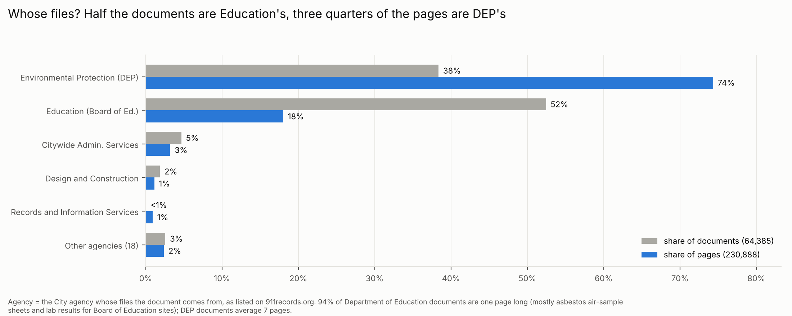
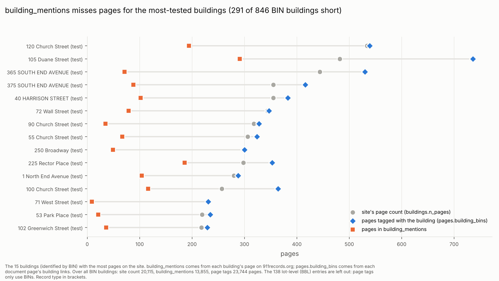

# What the released 9/11 records contain, and how complete our copy is

Code, how to run, outputs and checks: [`src/ingestion/README.md`](../src/ingestion/README.md) · Walkthrough: [`notebooks/00.data_ingestion.ipynb`](../notebooks/00.data_ingestion.ipynb)

## Summary

* **Our copy is complete.** 64,385 documents and all 230,888 of their pages, each with the PDF's own text. Every document has exactly the pages the site lists, and our entity links match the site's own counts for 15,583 of 15,586 entities.
* **The archive is two agencies' files.** By documents it is mostly the Department of Education's (52%, nearly all one-page asbestos air-sample sheets); by pages it is mostly DEP's (74%). Any count over the archive is first a count over these two agencies' files (fig I1).
* **The text is the PDFs' own text layer.** 99.6% of pages come straight from the PDF (`pdftotext`); 865 image-only pages were read with our OCR, and 1 page has no text. No page needed the site as a fallback.
* **The site's metadata is useful but not clean.** 20% of documents have no site date and others have impossible ones (year 1, 2019); the document-type field is empty; boxes and collections exist for only 38% of documents. These are corrected or flagged in processing ([report](01.processing_report.md)).
* **Three problems come from our own scrape, and are not fixed yet** (section 6):
  * 234 "documents" have an ID and nothing else; 223 of them are the last page of another document, picked up from the catalog-change pages.
  * `catalog_changes.change` is always "changed", so no document is marked as added or removed.
  * `building_mentions` misses pages for the most-tested buildings: 16,151 rows against 21,958 pages on the site. The page-level building tags are more complete (fig I2).

## 1. Motivation

Every result in this project is a count over the released records, so it is only as good as our copy of them and as clear as our knowledge of what they are. This step builds that copy from the public mirror (911records.org) and the City's portal, keeps it faithful to the sources, and checks it: is anything missing, what does the archive actually consist of, and which of the site's fields can be trusted as they are.

## 2. Questions

1. **Is our copy complete?** Every document, every page, every link the site shows.
2. **What is in the archive?** Whose files, what kinds of documents, how the text was obtained.
3. **What can be used as is, and what needs processing or fixing?**

## 3. Sources and approach in brief

* **911records.org** (an independent mirror of the City release): its HTML pages are scraped for document metadata, entity and building indexes, and catalog changes. It has no API.
* **The NYC 9/11 Document Portal** (`sept11documents.cityofnewyork.us`, the official copy): one PDF per document, or the mirror's bulk ZIPs.
* **Text** from each PDF page: the embedded text layer first, Tesseract OCR for image-only pages, the site's text as a last resort.
* **Output:** seven Parquet tables in `data/final/` (Appendix A), joined by `doc_id` + `page`, `entity_type` + `slug`, and `bin`. They are committed with Git LFS; nothing in them is corrected.
* **Fetching rules:** one request per second, `robots.txt` respected, identifiable user agent, everything cached. How each step works and how it is checked: the [folder README](../src/ingestion/README.md).

## 4. Results

### 4.1 Our copy is complete

| Check | Result |
| --- | --- |
| Documents with metadata, pages and a PDF | 64,385 |
| Pages | 230,888 = the sum of every document's page count; numbered 1 … n in every document |
| Bates page numbers | `bates_page` = `doc_id` + page − 1 on every page |
| Entity links | 650,196 page links; per entity, equal to the site's own page count for 15,583 of 15,586 entities |
| Joins | every entity and building mention points to an existing entity or building and an existing page |

The three entity exceptions are addresses on "Page Avenue", where the site's page count is the house number (555 Page Avenue: "555 pages", 1 link). Documents average 3.6 pages (median 1, maximum 620); 43,174 have a single page.

### 4.2 The archive is two agencies' files



The site lists the City agency whose files each document comes from. 23 agencies appear, but two dominate:

| Agency | Documents | Pages | Typical document |
| --- | --- | --- | --- |
| Education (Board of Education) | 33,765 (52%) | 41,619 (18%) | one page (94%): TEM asbestos air-count sheets and sample results, chains of custody |
| Environmental Protection (DEP) | 24,705 (38%) | 171,641 (74%) | longer: 7 pages on average (median 3) |
| Citywide Administrative Services | 3,014 (5%) | 7,400 (3%) | |
| Design and Construction | 1,207 (2%) | 2,611 (1%) | |
| 19 others | 1,694 (3%) | 7,617 (3%) | |

The release is organized in 9 production volumes. Only part of it keeps its physical filing: about 24,400 documents (38%) have a box and a collection (DEP Hard Copies, 68 boxes: 21,392; WTC 7: 3,027; DORIS Giuliani: 27). Every document has a folder code. The largest volume, NYC-WTC0008 (39,939 documents, including every Education document), has none.

**What this means for the analyses:** a count per month or per organization over the whole archive mixes a few thousand long DEP files with tens of thousands of one-page school air samples. Analyses should say which files they count, and pages and documents give different pictures.

### 4.3 The text is the PDFs' own

| Text source (`source`) | Pages |
| --- | --- |
| `pdftotext`: the PDF's embedded text layer (the same text the site shows) | 230,022 |
| `tesseract`: our OCR of an image-only page (median word confidence 75 of 100) | 865 |
| `none`: no text after OCR | 1 |
| `site`: the site's text as a fallback | 0 |

95.7% of pages start with the portal's header ("NYC 9/11 Public Portal Document") and carry Bates and litigation stamps; processing removes them. The site's own text label (`ocr_status`: ok 214,560 · ocr 10,232 · junk 3,982 · empty 2,114) describes the site's OCR, not the quality of the text for analysis; processing replaces it with a usable-text flag.

### 4.4 What the site's metadata gives, and what it doesn't

| Field | What we found | Handled in |
| --- | --- | --- |
| `site_date` | missing for 13,154 documents (20%); the earliest date anywhere in the text, so often a method date, a fax clock or a mention of 9/11; 40 dates before 1900 (39 in year 1) and one in 2019 (an OCR misread) | processing: corrected `doc_date` |
| `doc_type`, `title_confidence`, `doc_type_confidence` | empty (3 stray values) | processing drops them |
| `box`, `collection` | 38% of documents (`folder`: all) | kept as is |
| page `date` | always the document's date (`date_source` is "document" or "none") | processing |
| `entity_links` (pages), `confidence` (entity mentions) | always `[]` and always 1.0 | processing drops them |
| `contaminants` | tags on 100,826 pages (44%), 53 terms; asbestos and its fiber types dominate (asbestos 62,777 pages) | kept as is |
| entities | 15,915 in 7 types; the same organization often under several names; 329 "building" entities with no page links | processing merges names |

Entity links are dominated by substances: 412,140 of the 650,196 links (63%) are to substances such as asbestos; agencies 99,268, addresses 68,235, contractors 41,785, labs 24,158, signatories 4,610.

### 4.5 Two building-link tables that disagree



The site links buildings to pages in two places, and we keep both: each building's page (→ `building_mentions`) and each document page (→ `pages.building_bins`). They should agree, and they don't:

* For the 846 buildings identified by a BIN, the site reports 20,115 pages; `building_mentions` holds 13,855 and the page tags 23,744.
* `building_mentions` is short for 291 of them, mostly the buildings with the most environmental tests: 120 Church Street has 534 pages on the site, 194 in `building_mentions` and 539 page tags.
* The 138 lot-level (BBL) entries have no page tags, because tags use BINs only; some duplicate a BIN building (345 South End Avenue appears as a BIN with 21 pages and as a lot with 414).

**What this means for the spatial analysis:** counts of pages or tests per building from `building_mentions` alone undercount exactly the most-tested buildings. `pages.building_bins` is the more complete link for BIN buildings; the cause of the gap in `building_mentions` (probably pagination on the building pages) should be checked before relying on it.

### 4.6 The catalog of changes and the ID-only documents

The site records what the City added, changed or removed in each capture. We have five captures, 15 September – 19 October 2026 (794 rows), and two problems with how they were read:

* **The change type is lost.** The `change` column is "changed" in every row; the real type is at the start of `context`: 200 rows say "added", 30 say "changed", none says "removed". As a result, `documents.removed` is False for every document and `removed_date` is empty.
* **ID ranges became documents.** A change row shows a document's Bates range ("NYC-WTC_000003943 – NYC-WTC_000003950"), and the parser read both numbers as document IDs. 553 rows hold only such a range: 189 repeat a document already listed (the range's first number) and 364 list the range's last page as if it were a document. The end numbers then entered the master ID list: **234 `doc_id`s have no metadata, pages or PDF**, and 223 of them are exactly the last page of another document. The other 11 were found by the ID discovery but never scraped.

The 234 ID-only rows also pass into `data/processed/documents` (as undated documents with no pages). Until the parser is fixed, analyses should count documents that have pages (`n_pages` not missing).

## 5. How to use the raw tables

| Do | Not | Why |
| --- | --- | --- |
| Analyse `data/processed/`, not `data/final/` | — | dates, stamps, names and unrelated documents are handled there |
| Count documents that have pages (`n_pages` not missing) | all `doc_id`s | 4.6 |
| Count pages and documents separately, and say whose files | one archive-wide total | 4.2 |
| For buildings, compare `building_mentions` with `pages.building_bins` | `building_mentions` alone | 4.5 |
| Cite a page by `bates_page` and `url` | — | stable, matches the printed stamp and the site |
| Use `catalog_changes.context` for the change type | `change`, `removed` | 4.6 |

## 6. Caveats and what is not fixed

1. **ID-only documents (234).** Suggested fix: in `parsers.parse_change_capture`, take document IDs from links only, not from the text of a Bates range; then re-run `scrape_site` (cached, so no new requests) and `build_tables`.
2. **Change type.** Suggested fix: read the type from each row's own text (it starts with "added", "changed" or "removed") instead of the nearest heading, so `removed` can be set again.
3. **Building links.** `building_mentions` undercounts the most-tested buildings; the cause is not yet checked.
4. **The mirror is not the City portal.** Metadata (titles, dates, agencies, entity and building tags, contaminants) is the mirror's, produced by its own parsers. Only the PDFs, and so the text, come from the official release.
5. **A snapshot.** The City has kept adding documents (200 "added" rows in the five captures). Our copy reflects the scrape; the catalog captures record later changes.
6. **The one empty page and the 865 OCR'd pages** have lower-quality text; `source` and `ocr_confidence` mark them.

## 7. Why it matters

* **For this project:** the composition of the archive — half Education's one-page school samples, three quarters of the pages DEP's — shapes every count before any question is asked; the network report's "the record is DEP's view" starts here. Two of the scrape problems change counts directly (documents, buildings) and are cheap to fix from the cached HTML.
* **For work on released records generally:** checking a scrape against the site's own totals (pages per document, links per entity, pages per building) is quick and catches silent gaps that row counts alone hide.

---

## Appendix A. Data dictionary (`data/final/`)

Seven tables. "Site" = as shown on 911records.org; "ours" = computed during ingestion. Row counts are for the committed tables.

### A1. `documents` — 64,619 rows × 23 columns (64,385 scraped documents + 234 ID-only rows)

| Column | Source | Meaning |
| --- | --- | --- |
| `doc_id` | site | document ID = Bates number of its first page (`NYC-WTC_000000001`) |
| `bates_start` | ours | the number in `doc_id` |
| `bates_range` | site | first – last Bates number |
| `n_pages` | site | number of pages; missing for the ID-only rows |
| `file_size` | site | display string, e.g. `9 pages / 8.2 MB` |
| `collection`, `box` | site | physical filing (38% of documents) |
| `folder`, `folder_label` | site | folder code (all documents) and the folder's printed label (35%) |
| `agency` | site | City agency whose files the document comes from (23 agencies) |
| `production_volume` | site | release volume (`NYC-WTC0001` … `NYC-WTC0010`, 9 volumes) |
| `title`, `description` | site | the mirror's title and summary |
| `title_confidence`, `doc_type`, `doc_type_confidence` | site | empty |
| `site_date` | ours | parsed from `doc_date_raw`: the earliest date the site found in the text |
| `doc_date_raw` | site | every date the site found, ISO dates or OCR text |
| `removed`, `removed_date` | ours | from catalog changes; currently always False / empty (4.6) |
| `pdf_path` | ours | local path of the PDF (`data/raw/pdfs/…`, not committed) |
| `pdf_links` | site | the PDF's paths on the mirror and the City portal |
| `url` | ours | the document's page on 911records.org |

### A2. `pages` — 230,888 rows × 14 columns

| Column | Source | Meaning |
| --- | --- | --- |
| `doc_id`, `page` | ours | document and page number (1 … `n_pages`) |
| `text` | ours | page text (section 4.3), with the portal's header and stamps still in it |
| `source` | ours | `pdftotext`, `tesseract`, `site` or `none` |
| `ocr_confidence` | ours | Tesseract mean word confidence (0–100), where OCR ran |
| `bates_page` | ours | Bates number of the page |
| `date`, `date_source` | ours | the document's `site_date`; "document" or "none" |
| `url` | site | the page on 911records.org |
| `contaminants` | site | substances tagged on the page (list) |
| `ocr_status`, `ocr_source` | site | the site's text label (`ok`, `ocr`, `junk`, `empty`) and whose text it shows (`pdftotext`, `ours` = the site's OCR) |
| `entity_links` | site | always `[]` |
| `building_bins` | site | BINs of buildings linked to the page (JSON list) |

### A3. `entities` — 15,915 rows × 8 columns

| Column | Source | Meaning |
| --- | --- | --- |
| `entity_type` | site | agency 46, contractor 6,256, lab 1,136, substance 53, address 6,427, signatory 1,668, building 329 |
| `slug` | site | ID within its type; key with `entity_type` |
| `name`, `href` | site | display name; page on the site |
| `n_pages`, `n_docs` | site | pages and documents the site links to the entity |
| `first_date`, `last_date` | site | earliest and latest linked document date (text) |

### A4. `entity_mentions` — 650,196 rows × 7 columns

| Column | Source | Meaning |
| --- | --- | --- |
| `entity_type`, `slug` | site | the entity (no "building" type) |
| `doc_id`, `page` | site | the page it is linked to (one row per entity and page) |
| `link_text`, `row_text` | site | the link and its snippet as shown on the entity's page |
| `confidence` | site | always 1.0 |

### A5. `buildings` — 984 rows × 23 columns

| Column | Source | Meaning |
| --- | --- | --- |
| `bin`, `place_id`, `kind` | site | Building Identification Number, or `bbl:` lot ID for 138 entries; `kind` says which |
| `address`, `name`, `lat`, `lon` | site | location (14 without coordinates) |
| `record_type` | site | `test` 348, `inspection` 74, `mentioned` 562 |
| `n_docs`, `n_pages`, `n_records`, `n_source_pages`, `n_test_pages`, `n_inspection_pages`, `n_test_candidate_pages` | site | the site's counts of linked documents and pages |
| `first_date`, `last_date` | site | first and last linked document date (text) |
| `building_class`, `building_class_code` | site, ours | class label ("hotel (H5)") and its code, extracted by us (missing when the label has a letter-letter code; processing fills it) |
| `year_built`, `floors`, `units`, `building_area` | site | PLUTO-style attributes, as display strings for units and area |

### A6. `building_mentions` — 16,151 rows × 4 columns

| Column | Source | Meaning |
| --- | --- | --- |
| `bin`, `doc_id`, `page` | site | building and the page it is linked to, from the building's page (incomplete, 4.5) |
| `row_text` | site | snippet, with the site's extraction method and confidence |

### A7. `catalog_changes` — 794 rows × 4 columns

| Column | Source | Meaning |
| --- | --- | --- |
| `capture_date` | site | date of the capture (5 captures) |
| `change` | ours | currently always "changed" (4.6) |
| `doc_id` | site | document ID read from the row (including Bates range ends) |
| `context` | site | the row's text; starts with the change type |

## Reproduce

```bash
git lfs pull                              # the committed tables in data/final/
python -m src.ingestion.verify            # checks; ends with "all checks passed (known issues listed above)"
python -m src.ingestion.figures           # figures I1-I2
```

Re-running the scrape itself (hours, rate-limited) is described in the [folder README](../src/ingestion/README.md).
