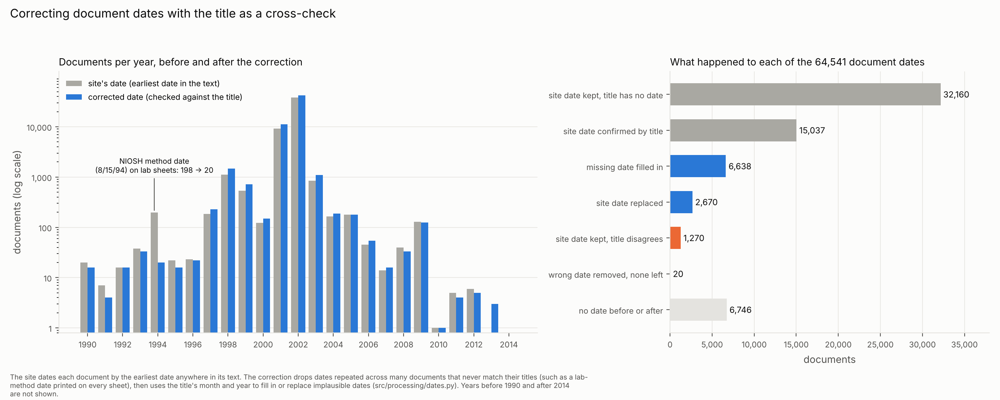
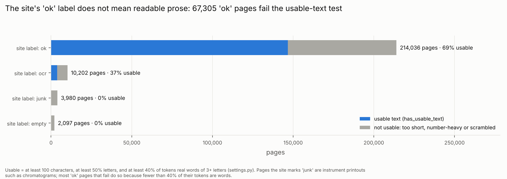

# What the archive gets wrong before any analysis: cleaning the 9/11 records

Code, how to run, outputs and checks: [`src/processing/README.md`](../src/processing/README.md) · Walkthrough: [`notebooks/01.process_pipeline.ipynb`](../notebooks/01.process_pipeline.ipynb)

## Summary

* **The site's dates create false history; the correction changed or flagged one document date in six.** The site dates each document by the earliest date anywhere in its text. That date is wrong or missing often enough to invent events: 198 documents are dated 1994, mostly 2001–2003 asbestos results that print a 1994 NIOSH method date on every sheet. After a correction that uses the title as a cross-check, 1994 holds 20 documents. In total, 6,638 missing dates were filled in, 2,670 wrong dates were replaced and 1,270 disagreements were flagged; undated documents fell from 13,384 to 6,766 (fig P1).
* **78 documents are not about 9/11.** They are City legal and insurance files (a 2007 steam-pipe explosion, Hurricane Irene, a Howard Beach flood) boxed with the 9/11 records. They were removed and listed, not silently dropped.
* **Every page carries stamps that would dominate any word count.** The portal header and Bates numbers are removed. Litigation stamps are removed from the text but kept as data: 57% of documents with pages carry a stamp from the WTC disaster-site litigation (21 MC 100) or a named subpoena, which records why each page was released.
* **Only 65% of pages are usable prose, and the site's label does not say which.** 67,305 pages the site marks "ok" are lab tables, forms or scrambled text (fig P2). A new flag, `has_usable_text`, selects the 150,550 pages fit for text analysis.
* **The same organization appears under several names.** 46 agency names become 30 agencies, each with a government level; 6,254 contractor names become 6,043 companies. Without this, one organization is several network nodes.
* **Nothing in `data/final/` is changed.** Every rule is a setting in one file, every changed value keeps its original next to it, and `verify.py` checks the result.

## 1. Motivation

The three analyses — the organization network, the spatial-equity analysis and the sentiment analysis — all count things in time: pages per month, organizations per page, words per document. The archive as scraped makes those counts wrong in predictable ways: its dates come from the wrong place in the text, its pages are full of stamps, its names are split, and part of it is about something else. This step finds those problems, fixes what can be fixed with a rule that can be checked, and flags the rest.

## 2. Questions

1. **What in the scraped archive would bias the analyses?** Which documents do not belong, which dates are wrong, which text is not text, which names are duplicates?
2. **Can each problem be fixed with a transparent rule?** One that can be stated in a sentence, changed in one setting and checked against the data.
3. **What can't be fixed, and how should each analysis handle it?**

## 3. Data and approach in brief

* **Input:** the eight tables built by ingestion in `data/final/` (64,619 documents, about 231,000 pages, 15,915 entity names, 984 buildings).
* **Output:** cleaned copies in `data/processed/`, with the same join keys (`doc_id` + `page`, `entity_id`, `bin`). The folder is gitignored; one command recreates it in about a minute.
* **Rules:** every step is a pure function of the tables, every threshold is in `src/processing/settings.py`, and every corrected value keeps its original column (`site_date` next to `doc_date`, `slug` next to `entity_id`, `litigation_stamp` next to the cleaned text).
* **Checks:** `python -m src.processing.verify` tests the rules on hand-made inputs and the output tables for bookkeeping, keys, joins and ranges (README, "Verification").

## 4. Results

### 4.1 78 documents are about something else

Searching titles for words like "flood" or "claim" also catches real 9/11 documents, so the rule uses the archive's own folder labels instead. All the unrelated material sits in two boxes, **DEP Box 41** and **GRM 010290082 - BOX 26**, whose folders include "2007 Steam Pipe Explosion - 41st St. + Lexington Ave", "Lyndenwood Flood - Howerd Bch 4-30-14", "Hurricane Irene - Lit Support" and 2014 insurance claims.

**Rule:** remove every document in those two boxes unless its title or description mentions the World Trade Center, Ground Zero or 9/11. Of the 87 documents in the boxes, 9 are kept for that reason (for example a 2013 WTC subpoena response and a legal hold notice for the WTC site).

**Result:** 78 documents (64 from DEP Box 41, 14 from GRM Box 26) and 573 pages removed from every table, and listed with box, folder and title in `removed_documents.parquet`.

### 4.2 The site's dates invent events; the title corrects them



**Why many dates are wrong.** The site picks the earliest date it finds anywhere in a document and does not read the title. The earliest date is often not the document's own:

| What the site picked up | Example | Effect |
| --- | --- | --- |
| A lab method date printed on every sheet | "NIOSH 7400, Revision 3, 8/15/94" | 181 documents dated 15 Aug 1994; most are 2001–2003 asbestos results |
| A lab form's revision date | "Revision 4/12/01" | 2002 lab sheets dated April 2001 |
| A fax machine with its clock never set | "01/01/1999" | 2002 letters dated New Year's Day 1999 |
| A mention of 9/11 itself | license agreements "since September 11, 2001" | 591 documents dated 9/11/2001; 162 after correction |
| A later print or scan date | a lab result printed "8/22/08" | an October 2001 test dated 2008 |
| A misread number | "May 28, 19^8" | a 1998 memo dated 2019 |

**The rule.** 25,604 titles end with the document's own month and year ("…, Oct 2001"), so the title is the cross-check:

1. Ignore dates outside 1900–2015 (misreads).
2. Ignore **repeated dates**: a date found in 10 or more documents whose titles never agree with it. Eight dates qualify, including 15 Aug 1994, 1 Jan 1999 and 12 Apr 2001.
3. If one of the document's own dates falls in the title's month, use it (the exact day, if the title gives one).
4. If the document's date is clearly wrong — missing, on or before 9/11 for a post-9/11 title, or more than a year after the title — use the title's date.
5. If the two disagree but both are believable, keep the document's own date and flag the conflict.

**Result.** Of 64,541 documents:

| What happened to the date | Documents |
| --- | --- |
| Site date kept; the title has no date to check it | 32,160 |
| Site date confirmed by the title | 15,037 |
| Missing date filled in from the title | 6,638 |
| Wrong site date replaced | 2,670 |
| Site date kept, but the title disagrees (flagged) | 1,270 |
| Wrong site date removed, nothing to replace it | 20 |
| No date before or after | 6,746 |

Undated documents fell from 13,384 to 6,766 (10.5%). 54,293 documents (84%) fall in the study window, 11 Sep 2001 – 31 Dec 2009. Older dates (1990s school asbestos records, 1997–98 7 WTC lease papers) are real; they are kept and marked as outside the window.

**Precision.** A date filled in from a title is only as precise as the title: 5,687 dates are known to the month and 1,039 to the year, stored as the 1st of the month or 1 January. `date_precision` says which (section 5).

### 4.3 Stamps removed from the text, but kept as evidence of why pages were released

Every page carries the portal header ("NYC 9/11 Public Portal Document") and a Bates number ("NYC-WTC 000125674"). Both are removed, whitespace is tidied, and words split across a line ("carry-" + "out") are rejoined.

Many pages also carry a **litigation stamp**, such as `CITY_21MC100_004219846`. "21 MC 100" appears to be the federal docket for the WTC disaster-site lawsuits, so these stamps likely mark pages the City produced as evidence; others name a subpoena. They are not words and would dominate word counts, so they are removed from the text, but they are kept in `litigation_stamp` (as printed) and `litigation_source` (OCR variants such as `CITY_2IMCl00` merged):

| `litigation_source` | Pages |
| --- | --- |
| 21MC100 (WTC disaster-site litigation) | 45,970 |
| DEP_WORBY_CANNATA_SUBP (subpoena) | 1,041 |
| Three DEP McGivney subpoenas (20 Broad, 63 Wall, 60 Broad) | 40 |
| No stamp | 183,264 |

36,475 of the 64,307 documents with pages (57%) carry at least one stamp. If the reading of the stamp is right, much of the archive was released because it was produced in litigation — context for the liability question and for whose files the record contains.

### 4.4 Only 65% of pages are usable prose, and the site's label does not say which



The site labels each page's text `ok`, `ocr`, `junk` or `empty`. The label is not a reliable guide to prose: 67,305 `ok` pages fail a basic test, mostly because fewer than 40% of their tokens are words (number tables, forms, scrambled OCR). The `junk` pages are instrument printouts such as chromatograms and metals reports; none passes the test.

`has_usable_text` is True when a page has at least 100 characters, is at least half letters, and at least 40% of its tokens are real words of 3 or more letters. **150,550 of 230,315 pages (65%) pass.** The three measures (`n_chars`, `alpha_ratio`, `word_ratio`) are kept so a stricter filter is one line.

### 4.5 One organization, several names

* **Agencies.** The site lists the same agency under several names ("DEP", "Department of Environmental Protection"). The 46 agency names are matched by hand to **30 agencies** in `agency_map.py`, each with a level: city 14, federal 7, state 4, private 2, nonprofit 2, regional 1. Two names of the Lower Manhattan Development Corporation, which the site filed as contractors, are moved to agencies. A new, unmapped agency name stops the run, so none slips through.
* **Contractors and labs.** Names are compared after removing endings like "Inc.", "LLC" and "Corp." and ignoring case and punctuation, so "ATC Associates Inc." and "Atc Associates" become one company. Names that shrink to a generic word ("Associates Inc.", "Construction Co.") are not merged, because they could be different firms. **6,254 contractor names → 6,043 companies; 1,136 lab names → 1,124 labs.**

Because merged names can point to the same page twice (9,475 mention rows repeat an organization on the same page), counts by `entity_id` must be deduplicated (section 5).

### 4.6 Buildings: numbers instead of display strings

"9 residential / 11 total" becomes `residential_units` and `total_units`; "157,426 sq ft" becomes `building_area_sqft`; missing class codes are filled from the class label ("hotel (H5)" → H5). `in_lower_manhattan` marks buildings inside the study area: 14 of 984 fall outside it. 27,606 pages name at least one building.

## 5. How to use the cleaned data

| Do | Not | Why |
| --- | --- | --- |
| Time series on `doc_date` | `site_date` | 4.2 |
| Counts by year: every dated document. By month: drop `date_precision == "year"`. By day or week: keep only `"day"` | all dates at day level | month- and year-only dates sit on the 1st and create false spikes |
| Robustness check on dates: keep `date_fix == "raw date matching title"` | — | the dates two sources agree on |
| Count organizations by `entity_id`, deduplicated per page or document | `slug` | 4.5 |
| Text and sentiment on `has_usable_text` pages | `ocr_status` | 4.4 |
| Study period on `in_study_window` | a hand-written date filter | one definition shared by all analyses |
| Study area on `in_lower_manhattan` | — | same bounding box everywhere |

**For each analysis:**
* **Network:** `entity_id` and the deduplicated pages; the date fixes decide which month each tie falls in.
* **Spatial equity:** `buildings` and `building_mentions` with `in_lower_manhattan`; page dates come from the corrected document date.
* **Sentiment:** `has_usable_text`, with stamps already out of the text. There is no document-type label (the site's `doc_type` is always empty), so memos and letters cannot yet be told apart from forms.

## 6. Caveats: what is not fixed

1. **Usable text still includes some forms.** Lab count sheets and forms with many labels pass the filter. Sentiment analysis may need a tighter filter, for example memos, letters and emails only.
2. **1,270 date conflicts were not checked by hand.** In the one spot-checked, the document's own date was right and the title wrong, which is why the rule keeps it.
3. **Some 7 WTC lease papers lost their date.** Their only date is a repeated approval date (3 Dec 1997), which the rule ignores; 12 of the 24 documents containing it end up undated.
4. **`n_pages` and `n_docs` in `entities` are the site's counts.** They include the removed documents and do not match a recount from `entity_mentions` for 692 entities. Recount from the mentions.
5. **Some extracted names are fragments** ("Mgmt Inc.", "St LLC"). Merging groups each fragment's variants into one `entity_id` but does not remove them; a few reach the network as "other / unknown" companies.
6. **A few general documents remain**, such as EPA guidance for auto repair shops, because they are not in the two unrelated boxes.
7. **218 badly scanned litigation stamps remain in the text** (for example "CITY_21MC:i00_…"), 0.5% of stamped pages.
8. **OCR spelling errors are not corrected** ("fnendly" for "friendly"). Automatic correction would also change names and technical terms.
9. **Rejoining split words also removes real hyphens at a line end** ("well-" + "known" → "wellknown"). This is rare.

## 7. Why it matters

* **For this project:** without the date correction, the network's monthly analysis and any time series would show activity in 1994 and 1999 that never happened, and would miss the 6,638 documents whose only date is in the title. Without name merging, organizations split into several nodes; without the stamps removed, docket and Bates numbers repeated on every page would count as words.
* **For work on released records generally:** portal metadata (dates, text labels, entity tags) is produced by automatic parsers and inherits their errors. Cross-checking it against a second field of the same record — here the title — fixes many errors with a rule that can be stated, audited and undone.

---

## Appendix A. Reference

### A1. Rows per table after cleaning

| Table | Rows | What changed |
| --- | --- | --- |
| documents | 64,541 | 78 unrelated documents removed; dates corrected; empty columns dropped; file size as a number |
| pages | 230,315 | pages of removed documents dropped; text cleaned; litigation stamps in their own columns; usable-text flag; corrected dates; building IDs as a list |
| entities | 15,915 | name variants merged into `entity_id`; agency level added |
| entity_mentions | 649,168 | removed documents dropped; `entity_id` and corrected `entity_type` added |
| buildings | 984 | display strings parsed into numbers; class codes filled in; `in_lower_manhattan` |
| building_mentions | 16,151 | removed documents dropped (none affected) |
| catalog_changes | 794 | capture dates parsed |
| removed_documents | 78 | new: the list of removed documents |

### A2. `date_fix` and `date_precision`

| `date_fix` | Meaning | Documents |
| --- | --- | --- |
| raw date (no title date) | the title has no date; the earliest date in the text is used (repeated dates skipped) | 32,171 |
| raw date matching title | a date in the text matches the title's month | 17,034 |
| title date (no raw date) | no usable date in the text; the title's date is used | 6,785 |
| title date (raw date implausible) | the text's date is clearly wrong; the title's date is used | 502 |
| raw date (conflicts with title) | both believable and they disagree; the text's date is kept | 1,283 |
| no date | no usable date anywhere | 6,766 |

These counts differ slightly from the table in 4.2, which compares the result with the site's date: for example, 1,997 documents where a date matching the title replaced the site's earliest date count as "raw date matching title" here and as "replaced" there.

| `date_precision` | Example `doc_date` | Means | Documents |
| --- | --- | --- | --- |
| day | 2001-09-19 | 19 Sep 2001 exactly | 51,049 |
| month | 2001-09-01 | some time in Sep 2001 | 5,687 |
| year | 2001-01-01 | some time in 2001 | 1,039 |

Pages have no dates of their own on the site; each page takes its document's corrected date.

### A3. Settings (judgment calls, all in `settings.py`)

| Setting | Value | What it does |
| --- | --- | --- |
| `EARLIEST_VALID_DATE` / `LATEST_VALID_DATE` | 1900-01-01 / 2015-12-31 | dates outside are misreads |
| `STUDY_START` / `STUDY_END` | 2001-09-11 / 2009-12-31 | defines `in_study_window` |
| `TITLE_YEAR_RANGE` | 1985–2015 | numbers outside it in a title are not years |
| `REPEATED_DATE_MIN_DOCS` | 10 | a date in this many documents that never matches their titles is ignored |
| `MIN_USABLE_CHARS` | 100 | shortest usable page |
| `MIN_ALPHA_RATIO` | 0.5 | share of letters needed |
| `MIN_WORD_RATIO` | 0.4 | share of real words needed |
| `OFF_TOPIC_BOXES` | DEP Box 41, GRM 010290082 - BOX 26 | boxes of unrelated documents |
| `LOWER_MANHATTAN_BBOX` | −74.03, 40.695, −73.97, 40.73 | study area for `in_lower_manhattan` |

### A4. Columns removed (always empty or constant)

* documents: `doc_type`, `title_confidence`, `doc_type_confidence`, `removed` (always False), `removed_date`
* pages: `entity_links` (always empty)
* entity_mentions: `confidence` (always 1.0)

## Reproduce

```bash
git lfs pull                              # real data/final/*.parquet
python -m src.processing.clean            # data/final -> data/processed (about a minute)
python -m src.processing.verify           # ends with "all checks passed"
python -m src.processing.figures          # figures P1-P2
```

Details and how to change a setting: [`src/processing/README.md`](../src/processing/README.md).