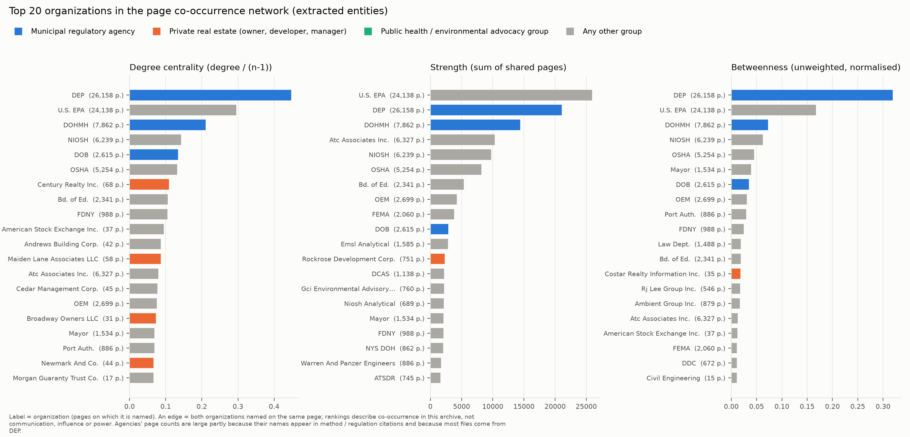
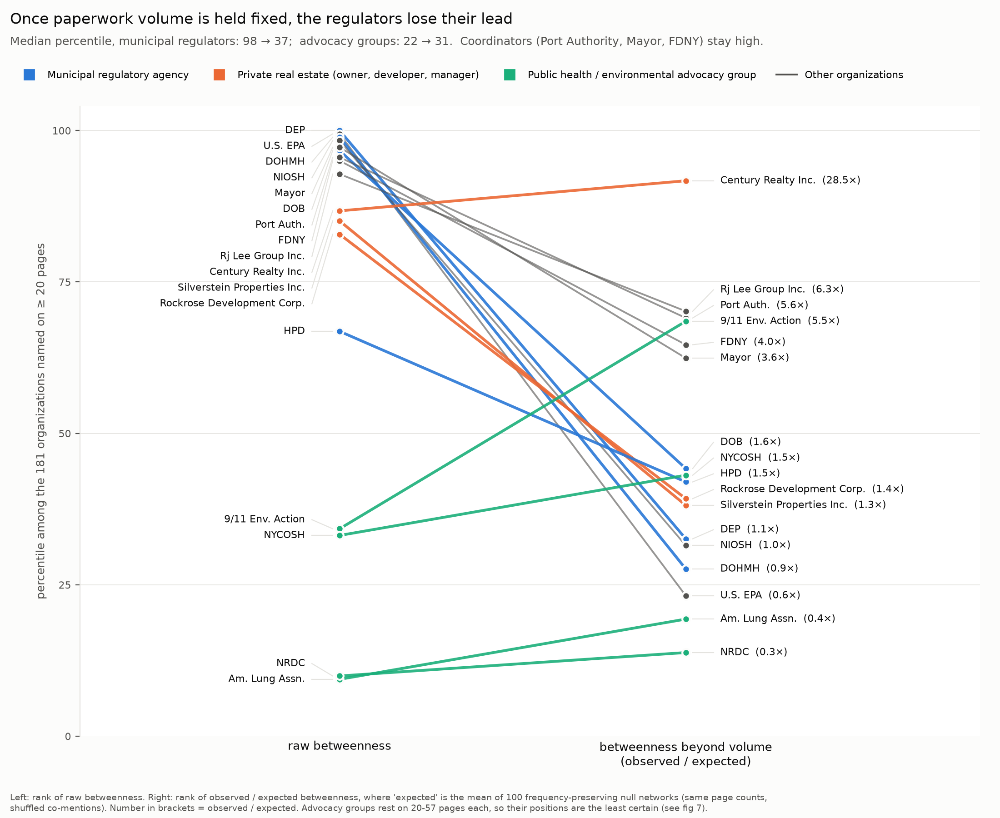
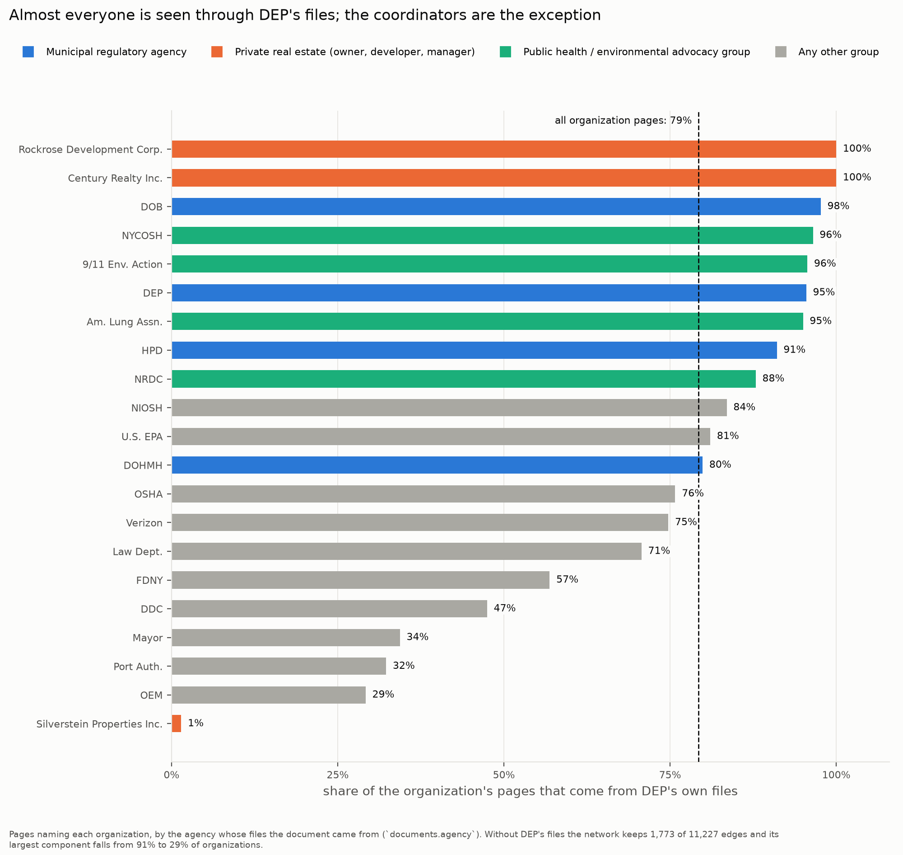
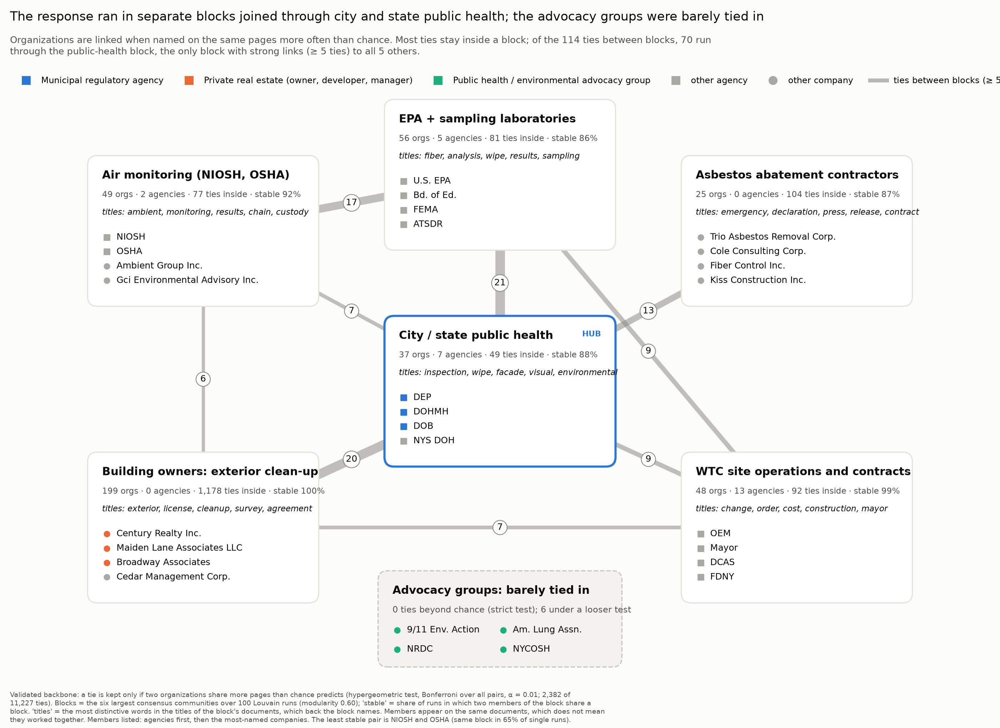
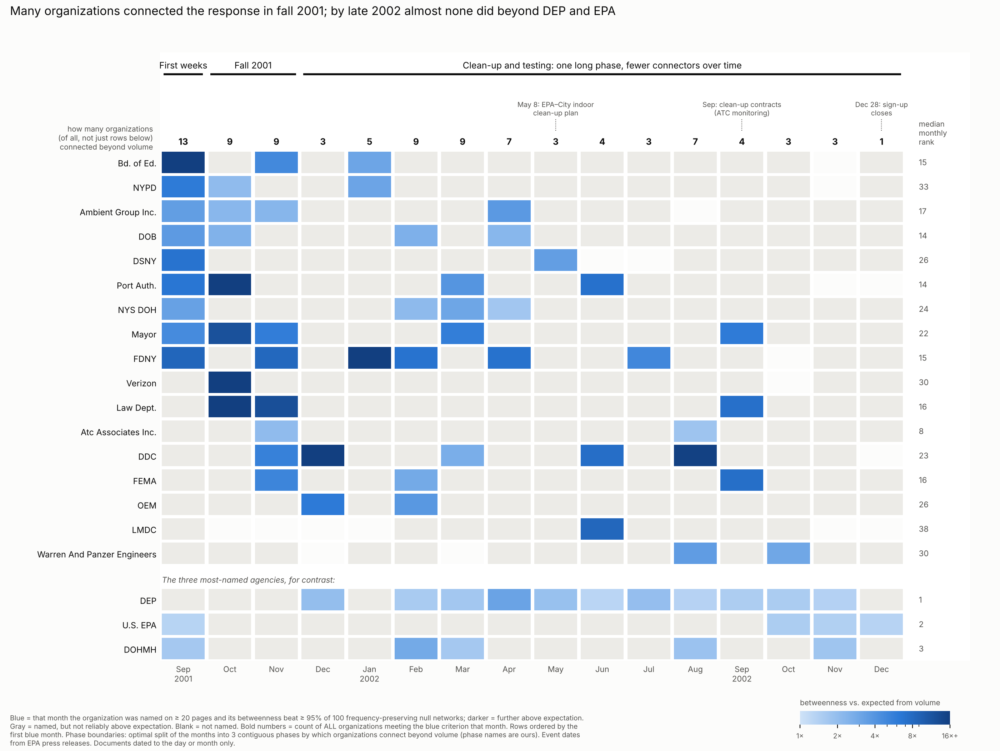
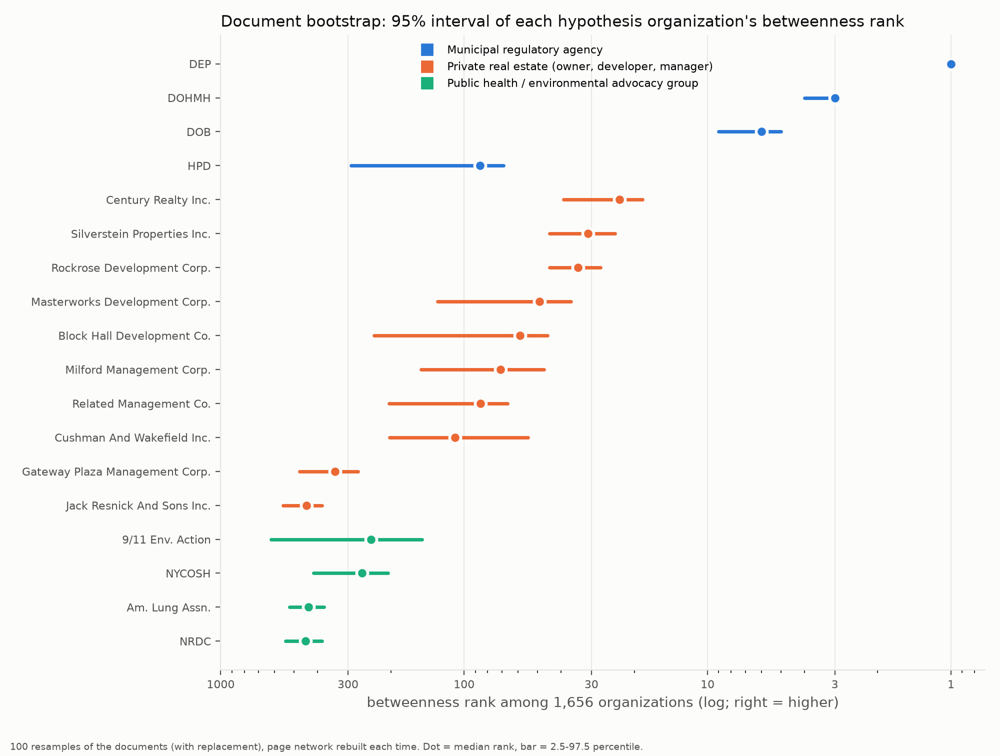
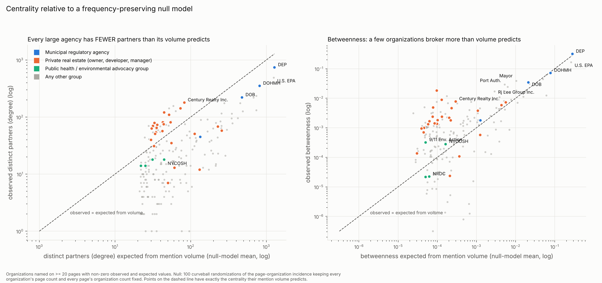
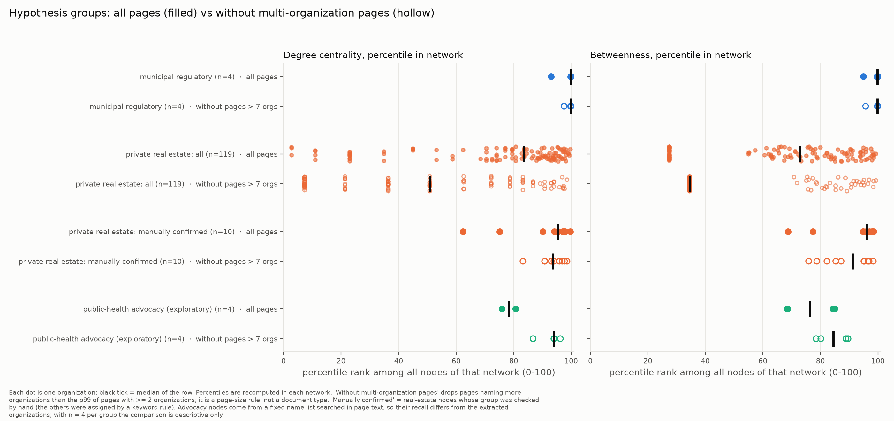

# Who held the 9/11 environmental response together? What the city's released records show, and what they hide

Code, how to run, outputs and checks: [`src/analysis/network/README.md`](../src/analysis/network/README.md) · Walkthrough: `notebooks/network_centrality.ipynb`

## Summary

* **The response was held together by many organizations in fall 2001, and by very few in 2002.** The number of organizations that connected the response *beyond their paperwork volume* fell from 13 in September 2001 to 1–4 per month in late 2002, when almost no one stands out beyond DEP and EPA. The data place the main break at the end of 2001 (fig 6).
* **The apparent center of the archive is mostly paperwork volume.** DEP, EPA and DOHMH top every raw ranking, but they are also named on the most pages. Once volume is held fixed, the municipal regulators fall from the 98th to the 37th percentile on betweenness (fig 8). The organizations that connect the response *more* than their volume predicts are coordinators (Port Authority, Mayor's Office, FDNY), a utility (Verizon) and testing labs (fig 5).
* **The record is DEP's view of the response.** 79% of all pages naming an organization come from DEP's own files. The coordinators are the exception: they are named across other agencies' records (fig 9).
* **The affected public is largely missing from the record.** The four advocacy groups found in the archive have no tie to any organization more frequent than chance under a strict test, and 6 in total under a looser one. Each city regulator has 13–38 (fig 10).
* **The response was organized in functional blocks**, joined mainly through a city/state public-health hub (fig 10). The blocks are building owners in DEP's exterior clean-up program, EPA + laboratories, WTC site operations and contracts, air monitoring, and abatement contractors. Each block's name is checked against the titles of its documents.
* **The lawyers moved toward the center through paperwork, not litigation.** The Law Department rose to the top 10 by late 2002, mostly through emergency-contract declarations and clean-up license agreements.

## 1. Motivation

The released records can show which organizations were involved in the 9/11 environmental response together, and when. Reading them as a network has a trap: an organization named on many pages is linked to almost everyone, whatever its role, so a naive network ranks **paperwork**, not **position**. This analysis measures both and separates them.

## 2. Questions

1. **Who appears central in the record, and is that position or volume?** Which organizations connect others in the record more than their mention volume alone predicts?
2. **How did the organizations holding the response together change over time?** Where are the breaks, and do they match what is known about the response?
3. **Whose view does the record carry, and who is missing from it?** How much of the structure comes from whose files were released, and where do community and advocacy voices appear?

*The original Hypothesis 1* — municipal regulatory agencies and private real-estate entities have higher degree and betweenness centrality than public-health advocacy groups — is tested along the way. Its answer is in section 4.7.

## 3. Data and approach in brief

* **Network.** 1,652 organizations (30 agencies, 1,622 companies) on 18,998 documents. Two organizations are linked when they are **named on the same page**. Four advocacy groups, which the archive's entity extraction never tagged, were added by a name search in page text. An edge means "recorded together", **not** communication.
* **Separating position from volume:**
  * **Null model:** a frequency-preserving null that keeps every organization's page count and every page's size, and shuffles who appears with whom (100 randomizations). It gives each organization's centrality "expected from volume alone".
  * **Validated backbone:** keeps only ties more frequent than chance (hypergeometric test).
  * **Communities:** consensus Louvain blocks over 100 runs on the validated backbone. Block names are checked against the most distinctive words in their documents' titles.
  * **Archive bias:** a network without DEP's own files.
  * **Uncertainty:** a document-level bootstrap.
  * **Time:** one network per month, September 2001 to December 2002, each with its own null model (100 samples). Phase boundaries come from an optimal split of the months, not from our labels.
* Data, definitions and detailed results: Appendix A. How each method is implemented, how to run it and how it is checked: the [folder README](../src/analysis/network/README.md).

## 4. Results

### 4.1 The raw network says the regulators are at the center

DEP is first on degree (742 partners) and betweenness, followed by EPA and DOHMH. They are the top 3 in every network variant (fig 1). Read at face value, this supports Hypothesis 1.



*Figure 1. Rankings in the main network. Centrality describes co-occurrence in the archive, not communication or power.*

### 4.2 But the raw center is mostly paperwork volume

Centrality rises with how often an organization is named (Spearman ρ = 0.44 for degree, 0.56 for betweenness; fig 3). DEP is named on 26,158 pages, the four advocacy groups on 20–57.


The null model measures each organization's centrality against what its volume alone predicts:
* **Degree is volume.** Every large agency has *fewer* distinct partners than its page count predicts: DEP 742 vs about 1,278 expected, ratio 0.58; EPA 0.39; DOHMH 0.43. Agencies are named again and again with the same partners on the same kinds of forms.
* **Betweenness separates connectors from busy agencies.** DEP (1.13×) and DOB (1.63×) connect slightly more than expected. EPA (0.64×), DOHMH (0.93×), NIOSH (1.02×) and OSHA (0.90×) do not.
* **Who connects more than volume predicts:** coordinators (Port Authority 5.6×, FDNY 3.9×, Mayor's Office 3.7×, NYPD 4.3×, Sanitation 3.7×), a utility (Verizon 10.4×), and testing and consulting firms (RJ Lee 5.9×, Athenica 6.1×).
* **Hypothesis 1, adjusted.** Among the 181 organizations named on 20 or more pages, the regulators' median betweenness percentile falls from 98 to 37. The advocacy groups' goes from 22 to 33 (fig 8). Median observed / expected betweenness is 1.28 for regulators vs 1.08 for advocacy groups, and 1.00 vs 1.01 when the null also holds fixed whose files each mention comes from.



*Figure 8. Each line is one organization: its betweenness percentile before (left) and after (right) holding paperwork volume fixed.*

### 4.3 The record is DEP's view; the coordinators are named across agencies

79% of all pages naming an organization come from DEP's own files. Without them the network falls apart: 1,773 of 11,227 edges remain, and the largest connected group falls from 91% to 29% of organizations. Almost everyone is seen through DEP's files:
* the advocacy groups: 88–96% of their pages;
* most real-estate firms: a median of 100%, from building and ownership lists;
* even the regulators: 80–98%.

The exceptions are the coordinators: OEM (29%), Port Authority (32%), Mayor's Office (34%) and DDC (47%), which are named across other agencies' records. This fits their high betweenness beyond volume (fig 9).



### 4.4 The advocacy groups are present but barely tied in

Only 21% of edges (2,382 of 11,227) are more frequent than chance, but they carry 56% of the evidence of who appears together. **None of the four advocacy groups keeps a single one.**

Under a looser rule (false-discovery rate, 4,338 edges) they keep 6 in total:
* NRDC with the Port Authority and the Lower Manhattan Development Corporation (the rebuilding bodies);
* NYCOSH with a Brookhaven laboratory and two consultants;
* the American Lung Association with one property firm.

Each municipal regulator keeps 13–38. The real contrast with the regulators is not a lower rank: regulators are *connected* and advocacy groups are *barely* connected. This holds under both rules.

### 4.5 The response was organized in functional blocks around a public-health hub

The validated backbone splits into clear blocks (modularity 0.60). They don't depend on chance: the consensus over 100 Louvain runs matches a single run almost exactly, and each block's members share a block in 88–100% of runs. Each block's name is checked against what its documents are about, using the most distinctive words in their titles:

| Block | Key members | Distinctive title words | What it is |
|---|---|---|---|
| Building owners | Century Realty, Maiden Lane Associates and ~200 owners; no agency | exterior, license, cleanup, survey, agreement | DEP's exterior building clean-up program: owners appear in DEP's files because DEP licensed the clean-up of their facades |
| EPA + sampling laboratories | EPA, Board of Education, FEMA, ATSDR, labs | fiber, analysis, wipe, results, sampling, school | dust and air sampling and its lab analysis, including schools |
| Air monitoring | NIOSH, OSHA, consultants | monitoring, results, chain of custody, sampling | workplace air monitoring |
| WTC site operations and contracts | OEM, Mayor's Office, DCAS, FDNY, NYPD, Port Authority, Verizon, DDC | change order, cost, construction | site work, contracts and costs |
| Asbestos abatement contractors | Trio Asbestos, Fiber Control, other abatement firms | emergency declaration, contract | abatement under emergency contracts |
| **City / state public health (hub)** | DEP, DOHMH, DOB, NYS DOH, Sanitation, CDC | inspection, wipe, facade, visual | building inspections |

Of the 114 validated ties between these blocks, 70 run through the public-health hub. It is the only block with strong links (5 or more ties) to all five others. The least stable pair is NIOSH and OSHA, in the same block in 65% of single runs.



*Figure 10. Consensus blocks of the validated backbone; "titles" lists each block's most distinctive document-title words. Members appear on the same documents (forms, lists, reports), which does not mean they worked together.*

### 4.6 Many connectors in fall 2001, few in 2002

Month by month, raw rank is nearly frozen: DEP and EPA are #1–2 on betweenness in all 16 months. But who connects the response **beyond their volume that month** changes, and the group narrows (fig 6).

**Phases from the data, not from our labels.** We split the 16 months optimally into contiguous phases by which organizations connect beyond volume:
* The main break falls at the end of 2001 (November or December, depending on the definition), and September 2001 stands apart from everything after it.
* 2002 is one long phase with a gradual decline, not a sequence of distinct stages.

| Phase (boundaries from the data; names ours) | Months | Organizations connecting beyond volume | Count per month |
|---|---|---|---|
| First weeks | Sep 2001 | Board of Education (schools near the site), FDNY, Sanitation, NYPD, Port Authority | 13 |
| Fall 2001 | Oct–Nov 2001 | Port Authority, Verizon (utility restoration), Law Department, Mayor's Office, DDC, FEMA | 9, 9 |
| Clean-up and testing | Dec 2001–Dec 2002 | changing sets: FDNY, DDC, OEM, Port Authority, LMDC, Mayor's Office, NYS DOH and testing / engineering firms; by late 2002 mostly EPA, DEP and DOHMH, just above expectation | 3–9 until April 2002, then 1–7 |

Within 2002 the count steps down from May 2002 (9, 9, 7 in February–April; 3–4 in most later months; 1 in December). May 2002 is the month EPA and the City announced the residential cleanup:
* The [Mayor asked EPA to address residential dust in April 2002](https://www.epa.gov/wtc), and EPA and the City announced the [indoor cleanup plan on 8 May 2002](https://www.epa.gov/archive/epapages/newsroom_archive/newsreleases/01d2bee13d698fbd852571650065cdaf.html).
* Contracts went to ATC Associates (monitoring) and Trio Asbestos (cleanup) [in September 2002](https://www.epa.gov/archive/epapages/newsroom_archive/newsreleases/48f42d5fe7e9afa2852571640069a45f.html).
* [Registration closed on 28 December 2002](https://webarchive.library.unt.edu/eot2008/20090116003408/http:/www.epa.gov/wtc/indoor.htm).

In the data, ATC's share of each month's pages climbs to 39% (September 2002), and Trio Asbestos anchors the abatement-contractor block. ATC's rise in rank (29 → 4) is volume, not brokerage: the testing contractors became central by producing the paper.

**The Law Department moves toward the center, through paperwork.** Its betweenness rank goes from 55 (September 2001) to 7–9 (September–December 2002), and it connects the record beyond its volume in October–November 2001 and September 2002. We classified its pages by document type and read a sample. In its peak months:
* 38% are emergency-contract declarations for DEP's air-monitoring and clean-up procurement, sent to the Corporation Counsel. The first, dated 13 September 2001, declares the attack an emergency under the City Charter.
* 14% are license agreements with building owners, approved "as to form" by the Corporation Counsel.
* 10% are document-preservation and legal-hold notices (from October 2001).
* Only 3% are legal correspondence, inquiries or claims.

DEP's most distinctive tie (2.7× expected) is with an extracted entity that is in fact the name of the Corporation Counsel. The lawyers moved toward the center mainly through the paperwork of emergency contracting and clean-up agreements, not litigation. Whether that went with more liability language is a question for the text analysis (H3).



*Figure 6. Blue = named on 20 or more pages that month and above 95% of that month's 100 null networks. Bold numbers = how many organizations (of all) met that bar each month. Phase boundaries come from an optimal split of the months; phase names are ours. Event dates are from EPA press releases.*

### 4.7 How sure are we, and what happens to Hypothesis 1

A document bootstrap resamples which documents were released (100 resamples, fig 7):
* DEP (rank 1) and DOHMH (rank 3) never move.
* "Every regulator above every advocacy group" holds in 100% of resamples on degree and 95% on betweenness.
* "All 119 real-estate firms above advocacy" on betweenness holds in only 39%.



| Part of Hypothesis 1 | Raw network | After holding volume (and archive) fixed | Verdict |
|---|---|---|---|
| Regulators rank above advocacy groups | Yes, in every variant and 95–100% of bootstrap resamples | The betweenness gap largely disappears (1.28× vs 1.08×; 1.00× vs 1.01×) | **The raw lead is real but mostly volume.** The robust difference is that advocacy groups are barely connected (0 ties beyond chance under the strict test, 6 under a looser one, vs 13–38 per regulator) |
| Real-estate firms rank above advocacy groups | Depends on which firms count; hand-confirmed 10 yes, all 119 unstable (39%) | Real-estate firms connect beyond volume, but only through building and ownership lists | **Not supported as a statement about influence**; it reflects how property lists are structured |
| Advocacy groups are least central | Yes on raw ranks | Barely connected rather than low-ranked; identified by a different method | **Supported in a different form:** they are at the edge of the recorded network |

## 5. Caveats

1. **Co-occurrence is not communication.** A shared page can be a letter, a list, a form header or a citation. The network shows who is *recorded together*, not who decided, talked or held power.
2. **Citations inflate some agencies.** 82% of NIOSH pages, 56% of EPA pages and 53% of OSHA pages also contain a method or regulation citation ("NIOSH 7400", "EPA Method", "40 CFR"). These are shares of pages containing a citation, not of mentions that are only citations.
3. **The record is mostly DEP's files** (79% of organization pages). Every comparison is largely a comparison inside one agency's view of the response.
4. **Extraction recall is uneven, and advocacy groups were found differently.** "Silverstein" appears in the text of 1,263 documents, but the extractor tagged Silverstein Properties in 790. Advocacy groups were never extracted: they come from a four-name text search, so their near-absence is partly a detection limit.
5. **The real-estate labels are imperfect.**
   * 99 of the 119 real-estate firms are labeled by keyword. The rule wrongly includes CoStar Realty Information, a data company.
   * Some well-known firms sit in "other / unknown", for example Rose Associates and Forest City.
   * The hand-confirmed real-estate firms are not a random sample: review concentrated on frequently named firms (median 72.5 pages vs 4 for keyword-classified ones). 909 companies remain unclassified, and some OCR fragments survive the filters.
   * The agency and regulator labels are curated by hand and reliable.
6. **Statistical limits.**
   * The edge test has little power for organizations on more than a third of all pages (DEP), so its few validated ties mean "what volume predicts", not "no ties". We checked this with a looser rule and with an observed / expected ranking of DEP's ties.
   * Monthly ratios for organizations with few pages in a month remain noisy even with 100 null samples, so a month counts only with 20 or more pages.
   * NIOSH and OSHA are the least stable pair within a block.
7. **Interpretation.** Phase boundaries and block members come from the data; their *names* are ours, checked against document titles. The links to documented events (cleanup program) are consistent in timing, but co-occurrence cannot show cause.
8. **Dates.** 12.5% of documents are undated, 15% of dated documents predate 9/11, and two dates (1908) are suspected errors. The main network pools all documents (88% of its evidence is from the study window); a study-window-only check gives the same conclusions (Appendix A7).
9. **Page size is not document type.** The page-size sensitivity check removes pages by how many organizations they name. Large pages include lists, form headers and letters.
10. **Small groups, no significance tests.** The regulator and advocacy groups have 4 organizations each, and nodes of one network are not independent, so group comparisons are descriptive.

## 6. Policy implications

These three implications follow directly from the network results.

1. **Recovery needs an owner as clear as the emergency.** Many organizations held the response together in fall 2001 and very few in 2002. The main break, at the end of 2001, is the handoff from emergency to clean-up, from emergency services and coordinators to contractors, and it is where responsibility can fall through. The [2003 directive on domestic incident management (HSPD-5)](https://www.govinfo.gov/content/pkg/PPP-2003-book1/html/PPP-2003-book1-doc-pg229.htm) later required crisis and consequence management to be treated as a single function. These records show what the 2001 response looked like before that rule existed.
2. **Affected communities need a formal seat.**
   * The advocacy groups are named mostly in DEP's files and barely tied to the agencies: no tie beyond chance under the strict test.
   * Their influence came from outside: the Inspector General's report followed [nearly two years of pressure from Congress members, labor and community activists](https://ehstoday.com/emergency-management/article/21905634/critics-epa-should-do-its-job-on-3rd-anniversary-of-damning-internal-report).
   * Lasting health care came only [in 2011](https://www.cdc.gov/WTC/laws.html).
   * Building community and worker groups into the response structure shortens that path.
3. **Disaster records should be preserved and released across all agencies.** When most of the record is one agency's files, any accountability review inherits that agency's view. Whose files are released changes what the record appears to say.

**For the joint discussion with the other two analyses.** Two further points depend more on the historical record than on this network, so they belong in the project-level conclusion:
* EPA's role in indoor air and public communication, which the sentiment analysis (H3) can test directly.
* Liability and compensation (the city's [$1 billion insurance fund](https://www.insurancejournal.com/news/national/2007/12/05/85419.htm)). Here the network only shows the Law Department's growing role in contracting paperwork (section 4.6).

## 7. Why it matters

* **For the history of 9/11:**
  * The records can date when the response narrowed: many connecting organizations in fall 2001, few in 2002, with the main break at the end of 2001.
  * They show which organizations connected the different parts of the response.
  * They show that the public the response was meant to protect is largely missing from the city's own record.
* **For research on released government records** (public-records requests, litigation discovery, archive releases):
  * Reading "named together often" as influence is common, and in this archive it would have been mostly wrong. Most raw centrality is volume and release bias.
  * Frequency-preserving null models, edge validation and time slicing are cheap, reproducible ways to separate structure from paperwork. They apply to any document release.

## 8. Conclusion

The released 9/11 records cannot show who held power. They do show the environmental response held together by many organizations in fall 2001 and by very few in 2002. It was organized in functional blocks (owners, labs, site operations, monitoring, abatement) joined mainly through city and state public health. And the lawyers became more central through the paperwork of emergency contracting. They also show that the advocacy groups, and the affected public the response served, sit at the very edge of the official record. The regulators' high raw centrality is real, but mostly reflects how much of the record is theirs.

---

## Appendix A. Data, methods and detailed results

### A1. Data and sample

* Raw data: the NYC 9/11 document archive as mirrored at <https://911records.org> (original PDFs from the City portal, `https://sept11documents.cityofnewyork.us/apps/content/September11_MD/{doc_id}.pdf`). The team scraped it into the Parquet tables in `data/final/` of the repository <https://github.com/dapivei/nyc-911-records-analysis> (Git LFS).
* Analysis input: the team's cleaned tables in `data/processed/` (`python -m src.processing.clean`, which removes 78 off-topic documents). Joins: `entity_mentions` → `pages` on `(doc_id, page)` → `documents` on `doc_id`. All keys are unique, and every mention joins to a page and a document (`outputs/network/data_key_checks.csv`).
* Organizations: entity types `agency` (30 organizations after the team's hand map) and `contractor`/`lab` (machine-extracted company names). Excluded: `signatory` (people and role labels), `address`, `building`, `substance`.
* Node identity: `agency:<entity_id>` / `company:<entity_id>`. 109 `entity_id`s are shared across entity types, so the type must be part of the key. Contractor and lab rows with the same normalised name form one company. Mentions are deduplicated per node and page: after `clean.py` merges name variants, 9,475 rows repeat.
* Company cleaning (`classify.py`, fixed before any metric was computed):
  * 33 hand-checked merges of OCR or prefix variants (e.g. "Landlord Silverstein Properties" → Silverstein Properties).
  * 24 listed artifacts (job titles such as "Agency Chief Contracting", accreditation phrases).
  * 332 names with no distinctive word ("Final Laboratory", "Services Inc.").
  * A minimum support of 2 documents per company.
* **Analysis sample:** 1,652 organizations (30 agencies + 1,622 companies) named on 18,998 documents.
* **Dates** (`run_metadata.json` → `date_coverage`). 16,623 of the 18,998 documents (87.5%) have a date; 14,121 fall in the study window (2001-09-11 to 2009-12-31), 2,493 predate 9/11, 9 are later than 2009, and 2,375 are undated. 78.7% of dated documents are from 2001–2002. How dates are corrected is documented in [`src/processing/README.md`](../src/processing/README.md); the extreme dates (including two suspected 1908 errors) are checked by hand in notebook section 1. **The main network is not filtered by date**: 88.1% of its pair evidence comes from study-window documents, 5.8% from before 9/11, 6.0% from undated documents (`evidence_by_date_period.csv`).
* **Coverage bias:** 62% of these documents come from DEP's files, 15% from the Dept. of Education and 11% from DCAS (`data_source_bias.csv`).

### A2. Network definition

| Element | Definition |
|---|---|
| Node | An organization (above). Attributes: name, group, pages and documents named, first and last document date. |
| Edge | Undirected. Two organizations named on the same **page**. Within a page each organization counts once, then each unordered pair once. No self-loops. |
| Weight | Number of distinct pages the pair shares (`n_docs` also kept). Used for strength and in fig4; degree and betweenness ignore it. |
| Provenance | `edge_evidence_main.parquet` lists every (source, target, doc_id, page) behind each edge. |

**Why page rather than document co-occurrence.** At the document level, the largest 1% of documents produce 70% of all pairs; one document names 312 organizations. At the page level the median page names one organization, the 99th percentile of multi-organization pages is 7, and the largest 1% of pages produce 26% of pairs (`data_unit_sizes.csv`). Document co-occurrence is kept only as a comparison network.

**Main network:** 1,652 nodes, 11,166 edges, density 0.008. 109 components; the largest holds 1,500 nodes (91%). 91 isolates. Median degree 5, maximum 738. Median edge weight 2, and 40% of edges have weight 1.

### A3. Organization groups (fixed before any result was computed)

The groups were set before results were computed (`outputs/network/org_classification.csv`, with basis and review status for every node):

| Group | n | Basis |
|---|---|---|
| Municipal regulatory | 4 | A-priori list: DEP, DOHMH, DOB, HPD. Other city bodies go to "city_other" (13). |
| Private real estate | 119 | 10 manual, 10 manual-uncertain (street-named partnerships, e.g. "Maiden Lane Associates"), 99 by keyword (Realty, Properties, Real Estate, Owners LLC), not checked one by one. Residential co-ops ("Owners Corp.", "Tenants Corp.") excluded. The 10 manual nodes are the **hand-confirmed** set used in the classification sensitivity check. |
| Public-health advocacy | **0 extracted** (4 in supplement) | See below. |
| Others | — | State, federal and bi-state agencies (18); consultants, contractors and labs (585); utilities (2); relief nonprofits (Red Cross, Salvation Army); other/unknown (909, left unclassified rather than forced into a group). |

**The hypothesis's third group does not exist in the extracted data.** The portal's extractor never tagged an advocacy organization. The only nonprofits in the agency map are relief organizations. Page text does name some advocacy groups, rarely. For an **exploratory supplement**, a fixed name list was searched in page text and four organizations were added:

| Organization | Pages | Documents |
|---|---|---|
| NYCOSH | 57 | 33 |
| NRDC | 33 | 21 |
| 9/11 Environmental Action | 23 | 14 |
| American Lung Association | 20 | 16 |

Two other list entries were dropped after a precision check, before any metric was computed: Sierra Club (all hits unrelated) and "Beyond Ground Zero" (it matches the plain phrase). These four nodes are found by a different method, with different recall, from every other node. Any comparison that involves them is therefore exploratory.

### A4. Methods: centrality, group comparison, sensitivity checks, validation

* **Node metrics** (networkx 3.6; exact algorithms):
  * degree;
  * degree centrality = degree / (n − 1);
  * strength = sum of edge weights (shared pages);
  * betweenness: unweighted shortest paths on the full network, normalised by (n−1)(n−2)/2. Exact Brandes algorithm, cost about O(n·m); a few seconds for this network, so no sampling.
  * Percentile rank (0–100) of each metric within its network, used to compare groups across networks of different size. Percentiles are recomputed in every network, so a group's percentile can rise while its raw degree or betweenness falls (when other nodes fall more). Raw degree, betweenness, ranks and `n_pages_used` are kept next to the percentiles (`hypothesis_nodes_by_scenario.csv`). `n_pages_used` is the number of distinct pages naming the node among the mentions kept by that variant's filters (page-size cut, study window), single-organization pages included; it is counted from mentions, not from edge evidence, so isolates keep their count.
* **Frequency check.** Spearman rank correlation between pages named and each metric (`frequency_check.csv`), shown in fig3.
* **Group comparison: descriptive only.** For each hypothesis group: n, median, quartiles, min and max of the percentile ranks, and every node of the two 4-node groups listed individually (`group_summary_by_scenario.csv`, `hypothesis_nodes_by_scenario.csv`). No significance test is reported, for three reasons:
  * nodes of one network are not independent observations;
  * the municipal-regulator and advocacy groups have 4 nodes each;
  * the advocacy nodes were found by a different method (text search) with different recall, which is a systematic difference that no p-value addresses.
* **Sensitivity checks** (`robustness.py`; each rebuilds the network and recomputes every metric and percentile):
  * **without multi-organization pages:** drop pages naming more than 7 organizations (the p99 of pages with ≥ 2). This is a page-size rule; it does not classify document types.
  * **document co-occurrence:** the unit rejected for the main analysis, as a comparison.
  * **study window only:** page co-occurrence using only mentions on documents with `in_study_window` (2001-09-11 to 2009-12-31). The same filter applies to the extracted entities and to the 4 text-search advocacy nodes; undated documents are dropped. **The node set is kept fixed** (1,656 nodes, as in every other variant), so the 158 nodes with no mention inside the window become isolates with tied lowest ranks. Keeping the denominator fixed keeps the percentiles of different variants on the same set of nodes. As a check on this choice, percentiles were recomputed within the subset of the 1,498 active nodes (still named in the window; `group_summary_window_refiltered.csv`). This check does not rebuild a smaller network: it keeps the full network's metrics and only recomputes the percentiles within the active-node subset. In a rebuilt smaller network, degree and the unnormalised betweenness path counts would be the same (the dropped nodes are isolates), but normalised betweenness would change, because it is divided by (n − 1)(n − 2) / 2 with the smaller n.
  * **classification:** all 119 real-estate nodes vs the 10 confirmed by hand (and the 20 manual ones including 10 marked uncertain), applied in every network.
* **Validation.** All results pass `python -m src.analysis.network.verify`; the checks are listed in the [folder README](../src/analysis/network/README.md#verification-verifypy).

### A5. Methods: separating position from volume (notebook section 6)

All on the page network with the 4 advocacy groups (1,656 nodes, node set fixed). Implementation and settings: [folder README](../src/analysis/network/README.md#layer-2-separating-position-from-paperwork-volume).

* **Null model.** Shuffles which organizations share a page while keeping every organization's page count and every page's size (100 randomizations). Reported per organization: observed / expected centrality, and the share of null networks it beats. A second version shuffles only within each agency's own files.
* **Hyperbolic weights.** A smooth alternative to the "> 7 organizations" page cut: a page naming *k* organizations adds 1/(*k* − 1) to each pair.
* **Validated backbone.** Keeps a tie only if two organizations share more pages than chance predicts (hypergeometric test, Bonferroni over all ≈ 1.37 M pairs); repeated with a looser false-discovery-rate rule.
* **Consensus blocks.** 100 Louvain runs on the backbone, combined into blocks that do not depend on the random seed; each block's name is checked against the most distinctive words in its documents' titles.
* **Without DEP's files / whose files.** The network rebuilt without documents from DEP's files, and each organization's share of pages that come from them.
* **Document bootstrap.** 100 resamples of the released documents.
* **Monthly networks and phases.** One network per month (September 2001–December 2002) with its own 100-sample null; an organization connects "beyond volume" in a month if it is named on ≥ 20 pages and beats ≥ 95% of that month's nulls. Phase boundaries are an exact optimal split of the months into contiguous phases.
* **Law Department documents.** Its pages classified by document type from titles, checked against 12 pages read in full.



*Figure 5. Observed vs expected centrality. The dashed line is the centrality an organization's mention volume predicts; points above it connect the record more than volume alone explains (summarized in fig 8, section 4.2).*

### A6. Detailed results for the original Hypothesis 1 (raw network)

These are the raw-network results that sections 4.1 and 4.7 summarize; read them with the volume adjustment in 4.2.

**Real-estate firms in the raw rankings.** Several enter the top 20 for degree while being named on few pages (Century Realty: degree 180, 68 pages). 53% of real-estate nodes' pair evidence comes from pages naming more than 7 organizations, against 7% for municipal regulators (`multi_org_page_share.csv`).

**Hypothesis groups** (supplement network with the 4 advocacy nodes; median percentile rank, degree / betweenness; fig2):

| View | n | Median pages named | All pages | Without multi-org. pages | Document co-occurrence | Study window only |
|---|---|---|---|---|---|---|
| Municipal regulatory | 4 | 5,239 | 99.8 / 99.8 | 99.8 / 99.8 | 99.5 / 99.5 | 99.8 / 99.8 |
| Private real estate: all | 119 | 5 | 83.6 / 72.9 | 50.8 / 34.5 | 81.2 / 68.1 | 83.8 / 74.2 |
| Private real estate: manual incl. uncertain | 20 | 51.5 | 95.9 / 94.9 | 93.1 / 86.3 | 95.7 / 94.8 | 95.6 / 94.4 |
| Private real estate: hand-confirmed | 10 | 72.5 | 95.3 / 96.0 | 93.6 / 91.2 | 96.2 / 96.0 | 92.0 / 95.5 |
| Public-health advocacy (exploratory) | 4 | 28 | 78.3 / 76.4 | 94.0 / 84.5 | 60.2 / 66.8 | 81.8 / 78.8 |



*Figure 2. Filled points use all pages; hollow points exclude pages naming more than seven organizations. Each point is an organization; black ticks mark medians. The figure shows all and hand-confirmed real-estate views. Percentiles are recalculated within each network; advocacy comparisons remain exploratory because identification methods differ.*

Raw values behind the percentiles (median degree / median betweenness ×1000):

| View | All pages | Without multi-org. pages | Document co-occurrence | Study window only |
|---|---|---|---|---|
| Municipal regulatory | 286.5 / 53.6 | 279 / 61.1 | 793 / 46.0 | 266.5 / 49.2 |
| Private real estate: all | 22 / 0.05 | 3 / 0.00 | 311 / 0.04 | 17 / 0.03 |
| Private real estate: hand-confirmed | 57.5 / 2.62 | 12.5 / 0.68 | 433 / 0.99 | 35 / 1.98 |
| Public-health advocacy (exploratory) | 16 / 0.15 | 13 / 0.15 | 49 / 0.04 | 15.5 / 0.12 |

Example of the percentile caveat: without multi-organization pages, the advocacy groups' median degree *falls* from 16 to 13, but their median degree percentile *rises* from 78.3 to 94.0, because most other nodes lose more partners.

* **Municipal regulators vs advocacy.** In all four networks, the lowest-ranked regulator is above the highest of the 4 advocacy groups found by text search, on both metrics (baseline: degree 93.0 vs 80.7, betweenness 94.9 vs 84.9). The margin is narrow on degree without multi-organization pages (97.5 vs 96.2) and on betweenness in the study window (89.6 vs 86.2). The two groups were identified differently (extracted entities vs a name search in page text), so this is a description of 8 organizations, not a confirmation of the hypothesis.
* **Real estate vs advocacy depends on which real-estate nodes are counted.**
  * All 119: above the advocacy groups on degree at baseline and in the study window, below on betweenness in both, and far below once multi-organization pages are removed.
  * Hand-confirmed 10: above the advocacy groups at baseline, in the document network and in the study window; without multi-organization pages, the median degree percentiles are close with real estate slightly lower (93.6 vs 94.0), and real estate is higher on betweenness (91.2 vs 84.5).
  * The confirmed firms are also named far more often (median 72.5 pages, vs 4 for the 99 keyword-classified firms). Classification, frequency and other firm characteristics (e.g. which firms the manual review chose to look at) are confounded here, so the data cannot say which of them drives the difference between the two views.

**Network overview** (fig4). The diagram shows a selected core of the supplement network, using all agencies, the 25 companies appearing in the most documents, and the four exploratory advocacy groups as candidates. Only edges supported by at least 10 shared pages are drawn; candidates with no edge at that threshold are omitted.


*Figure 4. Node size reflects pages named; edge width reflects shared pages. Squares represent agencies, circles companies, and diamonds advocacy groups. This is a filtered view of the network. Layout positions are not geographic locations, and links are not verified communication.*

### A7. Sensitivity checks (`robustness_summary.csv`, fig2)

| Network | Nodes | Edges | Largest component | Isolates |
|---|---|---|---|---|
| Baseline: page co-occurrence | 1,656 | 11,227 | 90.8% | 91 |
| Page, without multi-organization pages (> 7 orgs) | 1,656 | 5,122 | 82.3% | 241 |
| Document co-occurrence | 1,656 | 93,053 | 98.6% | 16 |
| Page, study window only | 1,656 | 9,429 | 82.1% | 245 |

* **Top agencies are stable.** DEP, EPA and DOHMH are the top 3 on degree and betweenness in all four networks, and NIOSH is in the top 5 in all of them (with DOB or OSHA).
* **Removing multi-organization pages halves the edges** and is what moves the real-estate results. It affects the 119-node view most because 28 of its nodes become isolates.
* **Classification matters for the real-estate half**, as shown above. It does not affect the municipal comparison.
* **Study window only** (`hypothesis_nodes_by_scenario.csv`, `group_summary_window_refiltered.csv`):
  * The relative order of the 8 municipal and advocacy organizations keeps every regulator above every advocacy group. On degree, DEP, DOHMH and DOB stay 1st, 3rd and 6th (DOB was 5th), and HPD moves from 116th to 106th. On betweenness, HPD falls from 86th to 174th, still above the best-ranked advocacy group (230th). The four advocacy groups rank 241st–341st (baseline 313th–395th), and their internal order changes slightly. Raw degree falls or stays the same for all 8; the advocacy groups' percentiles rise because other nodes lose more (245 nodes are isolates, 158 of them with no mention left).
  * Real estate: the comparisons with advocacy keep the same direction as at baseline for both classification views (all 119: above on degree, below on betweenness; hand-confirmed 10: above on both). Some firms drop sharply: Silverstein Properties is named on 891 pages, but only 14 of them are in the window (846 are on pre-9/11 documents, mostly 1998–1999 DCAS files), so its degree falls from 58 to 21. Four of the 119 real-estate nodes have no mention in the window.
  * Recomputing the percentiles within the subset of 1,498 active nodes (no network rebuilt) gives the same pattern: municipal minimum 92.9 / 88.5 vs advocacy maximum 83.4 / 84.7; all real estate 82.0 / 72.1 vs advocacy 79.9 / 76.6; hand-confirmed 91.2 / 95.0.

## Reproduce

```bash
git lfs pull                            # real data/final/*.parquet
python -m src.processing.clean          # data/final -> data/processed
python -m src.analysis.network.run      # all tables and figures (~30 min the first time, then a few minutes)
python -m src.analysis.network.verify   # ends with "all checks passed"
```

Details, saved samples and how to change a setting: [`src/analysis/network/README.md`](../src/analysis/network/README.md).