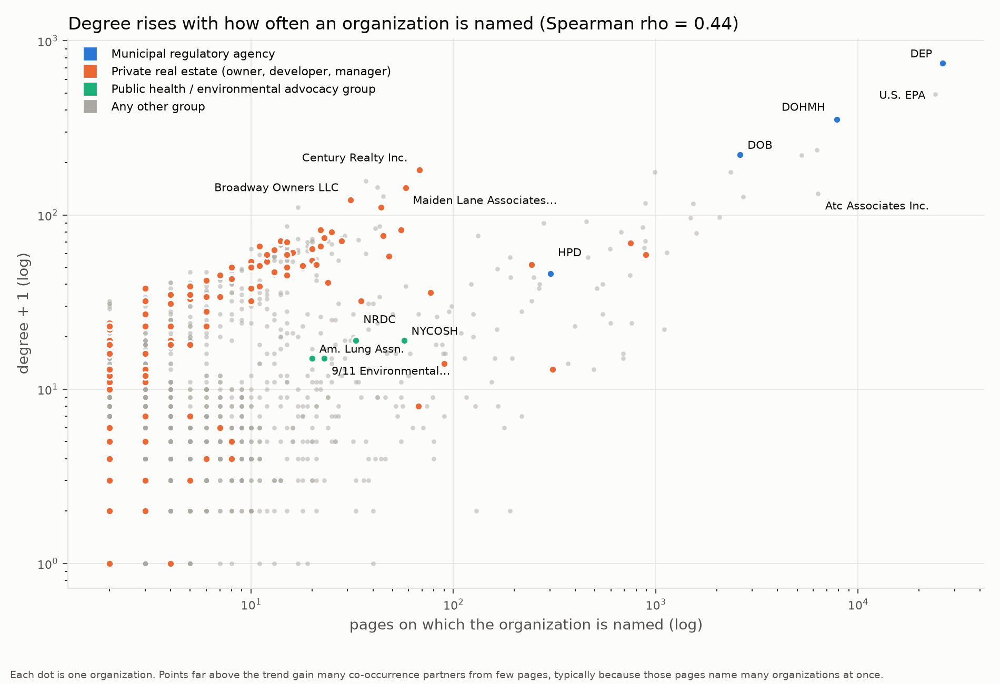
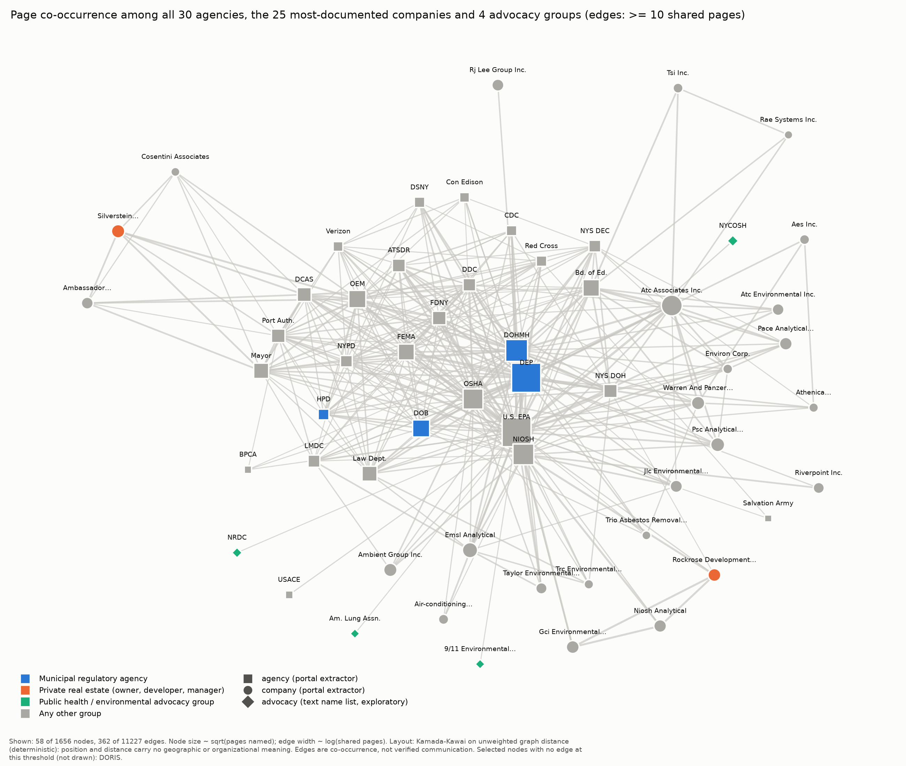

# RQ1 — Organization Co-occurrence Network in the Post-9/11 Records

*DS-GA 1007 group project — analysis direction 1 (Network Topology / Centrality).*
Code: `src/analysis/network/` · Notebook: `notebooks/network_centrality.ipynb` · Tables: `outputs/network/` · Figures: `outputs/figures/network/`

## 1. Research question

**Original question.** How did inter-agency communication networks operate?
**Hypothesis 1.** Municipal regulatory agencies and private real-estate entities will exhibit higher betweenness and degree centrality than public-health advocacy groups.

**What the data can answer.** The archive records which organizations are *named on the same page*. That supports a co-occurrence network, not a communication network: there are no reliable sender/recipient fields, so we cannot observe who wrote to whom. The question actually tested is:

> In the released archive, which organizations occupy central positions in the page-level co-occurrence network, and do municipal regulators and private real-estate entities rank above public-health advocacy groups?

## 2. Data and sample

* Raw data: the NYC 9/11 document archive as mirrored at <https://911records.org> (original PDFs from the City portal, `https://sept11documents.cityofnewyork.us/apps/content/September11_MD/{doc_id}.pdf`). The team scraped it into the Parquet tables in `data/final/` of the repository <https://github.com/dapivei/nyc-911-records-analysis> (Git LFS).
* Analysis input: the team's cleaned tables in `data/processed/` (`python -m src.processing.clean`, which removes 78 off-topic documents). Joins: `entity_mentions` → `pages` on `(doc_id, page)` → `documents` on `doc_id`. All keys are unique, and every mention joins to a page and a document (`outputs/network/data_key_checks.csv`).
* Organizations: entity types `agency` (30 organizations after the team's hand map) and `contractor`/`lab` (machine-extracted company names). Excluded: `signatory` (people and role labels), `address`, `building`, `substance`.
* Node identity: `agency:<entity_id>` / `company:<entity_id>`. 109 `entity_id`s are shared across entity types, so the type must be part of the key. Contractor and lab rows with the same normalised name form one company. Mentions are deduplicated per node and page: after `clean.py` merges name variants, 9,475 rows repeat.
* Company cleaning (`classify.py`, fixed before any metric was computed):
  * 33 hand-checked merges of OCR or prefix variants (e.g. "Landlord Silverstein Properties" → Silverstein Properties).
  * 24 listed artifacts (job titles such as "Agency Chief Contracting", accreditation phrases).
  * 332 names with no distinctive word ("Final Laboratory", "Services Inc.").
  * A minimum support of 2 documents per company.
* **Analysis sample:** 1,652 organizations (30 agencies + 1,622 companies) named on 18,998 documents.
* **Date coverage** (`run_metadata.json` → `date_coverage`; denominators stated):
  * 16,623 of the 18,998 documents (87.5%) have a `doc_date`; 641 of these are year-only and 2,720 month-only.
  * 14,121 fall in the study window 2001-09-11 to 2009-12-31: 74.3% of all documents, or 85.0% of dated ones.
  * 78.7% of dated documents are from 2001–2002.
  * The 18,998 documents fall into four non-overlapping periods: 14,121 in the study window, 2,493 before 11 September 2001, 9 after 2009, and 2,375 undated (14,121 + 2,493 + 9 + 2,375 = 18,998). Of the 2,493 pre-9/11 documents, 1,969 are from 1997–2000 and 127 from before 1997 (subsets, not extra documents).
  * **Stored date range: 1908-05-28 to 2013-11-01.** This is the value in `doc_date` as cleaned by `src/processing`; this analysis does not change it.
  * **Extreme dates, checked by hand** (`data_date_extremes.csv`: the 10 earliest and 10 latest documents, with raw dates and the cleaning rule applied):
    * The two **1908** documents are **suspected date errors** (manual judgement). Both are the same one-page Office of Contracts cover sheet (DCAS files, box 7DCAS) addressed to "7 World Trade Company, L.P."; the extracted page text reads "DATE: May 28, 1908", and one of the two titles says July 1995. A 1908 date is implausible for a cover sheet addressed to that company. The original PDFs were not checked, so it is not known whether "1908" is printed on the page or comes from text extraction, and no corrected date is assumed. The cleaning kept the stored date because its rules only override raw dates that are missing, on or before 9/11 for a post-9/11 title, or more than a year after the title.
    * The other 8 of the 10 earliest (1982–1986) are sewer, drainage and tunnel memos and letters (10th Ave tunnel, Lincoln Tunnel, convention center, WTC tunnel drawings), all from DEP Box 44. In every case the title gives the same month and year as the date, and for the 1982 memo the page text does too ("March 9, 1982"). They look like genuine older material in DEP's files. The remaining 117 pre-1997 documents were not checked one by one.
    * The latest (2011–2013) are asbestos lab reports, chain-of-custody forms and a subpoena receipt. Their dates come from the title or agree with it, and are plausible. Two of the 2011 lab summaries took the title year over raw dates from 1994 and 2001.
    * Excluding the two suspected errors, the range is 1982–2013. These are document dates, not proof that the events they describe happened in those years.
  * **The main network is not filtered by date.** It pools every document, dated or not. By the period of its document, the main network's pair evidence (one row per pair and page) is 88.1% study window, 5.8% before 11 September 2001, 6.0% undated and 0.02% after 2009 (`evidence_by_date_period.csv`). It describes the released archive, not only the post-9/11 response period. A study-window-only network is run as a sensitivity check (section 7).
* **Coverage bias:** 62% of these documents come from DEP's files, 15% from the Dept. of Education and 11% from DCAS (`data_source_bias.csv`).

## 3. Network definition

| Element | Definition |
|---|---|
| Node | An organization (above). Attributes: name, group, pages and documents named, first and last document date. |
| Edge | Undirected. Two organizations named on the same **page**. Within a page each organization counts once, then each unordered pair once. No self-loops. |
| Weight | Number of distinct pages the pair shares (`n_docs` also kept). Used for strength and in fig4; degree and betweenness ignore it. |
| Provenance | `edge_evidence_main.parquet` lists every (source, target, doc_id, page) behind each edge. |

**Why page rather than document co-occurrence.** At the document level, the largest 1% of documents produce 70% of all pairs; one document names 312 organizations. At the page level the median page names one organization, the 99th percentile of multi-organization pages is 7, and the largest 1% of pages produce 26% of pairs (`data_unit_sizes.csv`). Document co-occurrence is kept only as a comparison network.

**Main network:** 1,652 nodes, 11,166 edges, density 0.008. 109 components; the largest holds 1,500 nodes (91%). 91 isolates. Median degree 5, maximum 738. Median edge weight 2, and 40% of edges have weight 1.

## 4. Organization groups

The groups were set before results were computed (`outputs/network/org_classification.csv`, with basis and review status for every node):

| Group | n | Basis |
|---|---|---|
| Municipal regulatory | 4 | A-priori list: DEP, DOHMH, DOB, HPD. Other city bodies go to "city_other" (13). |
| Private real estate | 119 | 10 manual, 10 manual-uncertain (street-named partnerships, e.g. "Maiden Lane Associates"), 99 by keyword (Realty, Properties, Real Estate, Owners LLC), not checked one by one. Residential co-ops ("Owners Corp.", "Tenants Corp.") excluded. The 10 manual nodes are the **hand-confirmed** set used in the classification sensitivity check. |
| Public-health advocacy | **0 extracted** (4 in supplement) | See below. |
| Others | — | State, federal and bi-state agencies (18); consultants, contractors and labs (585); utilities (2); relief nonprofits (Red Cross, Salvation Army); other/unknown (909, left unclassified rather than forced into a group). |

**The hypothesis's third group does not exist in the extracted data.** The portal's extractor never tagged an advocacy organization. The only nonprofits in the agency map are relief organizations. Page text does name some advocacy groups, rarely. For an **exploratory supplement**, a fixed name list was searched in page text and four organizations were added:

| Organization | Pages | Documents |
|---|---|---|
| NYCOSH | 57 | 33 |
| NRDC | 33 | 21 |
| 9/11 Environmental Action | 23 | 14 |
| American Lung Association | 20 | 16 |

Two other list entries were dropped after a precision check, before any metric was computed: Sierra Club (all hits unrelated) and "Beyond Ground Zero" (it matches the plain phrase). These four nodes are found by a different method, with different recall, from every other node. Any comparison that involves them is therefore exploratory.

## 5. Methods

* **Node metrics** (networkx 3.6; exact algorithms):
  * degree;
  * degree centrality = degree / (n − 1);
  * strength = sum of edge weights (shared pages);
  * betweenness: unweighted shortest paths on the full network, normalised by (n−1)(n−2)/2. Exact Brandes algorithm, cost about O(n·m); a few seconds for this network, so no sampling.
  * Percentile rank (0–100) of each metric within its network, used to compare groups across networks of different size. Percentiles are recomputed in every network, so a group's percentile can rise while its raw degree or betweenness falls (when other nodes fall more). Raw degree, betweenness, ranks and `n_pages_used` are kept next to the percentiles (`hypothesis_nodes_by_scenario.csv`). `n_pages_used` is the number of distinct pages naming the node among the mentions kept by that variant's filters (page-size cut, study window), single-organization pages included; it is counted from mentions, not from edge evidence, so isolates keep their count.
* **Frequency check.** Spearman rank correlation between pages named and each metric (`frequency_check.csv`), shown in fig3.
* **Group comparison: descriptive only.** For each hypothesis group: n, median, quartiles, min and max of the percentile ranks, and every node of the two 4-node groups listed individually (`group_summary_by_scenario.csv`, `hypothesis_nodes_by_scenario.csv`). No significance test is reported, for three reasons:
  * nodes of one network are not independent observations;
  * the municipal-regulator and advocacy groups have 4 nodes each;
  * the advocacy nodes were found by a different method (text search) with different recall, which is a systematic difference that no p-value addresses.
* **Sensitivity checks** (`robustness.py`; each rebuilds the network and recomputes every metric and percentile):
  * **without multi-organization pages:** drop pages naming more than 7 organizations (the p99 of pages with ≥ 2). This is a page-size rule; it does not classify document types.
  * **document co-occurrence:** the unit rejected for the main analysis, as a comparison.
  * **study window only:** page co-occurrence using only mentions on documents with `in_study_window` (2001-09-11 to 2009-12-31). The same filter applies to the extracted entities and to the 4 text-search advocacy nodes; undated documents are dropped. **The node set is kept fixed** (1,656 nodes, as in every other variant), so the 158 nodes with no mention inside the window become isolates with tied lowest ranks. Keeping the denominator fixed keeps the percentiles of different variants on the same set of nodes. As a check on this choice, percentiles were recomputed within the subset of the 1,498 active nodes (still named in the window; `group_summary_window_refiltered.csv`). This check does not rebuild a smaller network: it keeps the full network's metrics and only recomputes the percentiles within the active-node subset. In a rebuilt smaller network, degree and the unnormalised betweenness path counts would be the same (the dropped nodes are isolates), but normalised betweenness would change, because it is divided by (n − 1)(n − 2) / 2 with the smaller n.
  * **classification:** all 119 real-estate nodes vs the 10 confirmed by hand (and the 20 manual ones including 10 marked uncertain), applied in every network.
* **Validation** (`python -m src.analysis.network.verify`, all pass):
  * every metric matches hand-computed values on a toy graph, including the page-size filter;
  * nodes and edges are unique, edges ordered, with no self-loops;
  * the number of evidence rows equals Σ C(k, 2) over pages, so the join does not inflate rows;
  * 25 edge weights match an independent recount from raw `entity_mentions`;
  * betweenness on the agency subgraph equals a separate networkx computation;
  * baseline group medians match a direct recomputation from the saved node table;
  * in the study-window network, the pages used by each municipal and real-estate node match a recount from the raw `entity_mentions` and `documents` tables;
  * under the page-size cut, `n_pages_used` is correct on a toy network run through `build_network` (single-organization pages kept, isolates counted) and matches a recount from raw mentions for every hypothesis node;
  * the notebook's metrics and group summaries equal the saved tables.

## 6. Results

**Rankings** (`nodes_main.csv`, fig1). DEP has the highest degree centrality (0.45, 738 partners) and betweenness (0.32). U.S. EPA is second on both, and first on strength. Next come DOHMH and NIOSH; DOB (degree) and OSHA (betweenness) complete the top 5. Several real-estate firms enter the top 20 for degree while being named on few pages: Century Realty (degree 180, 68 pages), Maiden Lane Associates and Broadway Owners LLC. 53% of real-estate nodes' pair evidence comes from multi-organization pages (more than 7 organizations), against 7% for municipal regulators (`multi_org_page_share.csv`). The 15 largest pages are a mix of building / property lists, DEP inspection-form headers and at least one Law Department letter, so page size and document type are not the same thing.


*Figure 1. Rankings in the main extracted-organization network. Colors indicate groups; labels include pages named. Centrality describes co-occurrence in the archive, not communication or power.*

**Frequency** (`frequency_check.csv`, fig3). Spearman correlation with pages named: degree 0.44, betweenness 0.56, strength 0.64. The most central agencies are also by far the most named (DEP 26,158 pages; the four advocacy groups 20–57).



*Figure 3. Each point is an organization; both axes use log scales (vertical axis: degree + 1). Mention frequency and degree are positively associated. This relationship does not establish causality or control for frequency.*

**Hypothesis groups** (supplement network with the 4 advocacy nodes; median percentile rank, degree / betweenness; fig2):

| View | n | Median pages named | All pages | Without multi-org. pages | Document co-occurrence | Study window only |
|---|---|---|---|---|---|---|
| Municipal regulatory | 4 | 5,239 | 99.8 / 99.8 | 99.8 / 99.8 | 99.5 / 99.5 | 99.8 / 99.8 |
| Private real estate: all | 119 | 5 | 83.6 / 72.9 | 50.8 / 34.5 | 81.2 / 68.1 | 83.8 / 74.2 |
| Private real estate: manual incl. uncertain | 20 | 51.5 | 95.9 / 94.9 | 93.1 / 86.3 | 95.7 / 94.8 | 95.6 / 94.4 |
| Private real estate: hand-confirmed | 10 | 72.5 | 95.3 / 96.0 | 93.6 / 91.2 | 96.2 / 96.0 | 92.0 / 95.5 |
| Public-health advocacy (exploratory) | 4 | 28 | 78.3 / 76.4 | 94.0 / 84.5 | 60.2 / 66.8 | 81.8 / 78.8 |


*Figure 2. Filled points use all pages; hollow points exclude pages naming more than seven organizations. Each point is an organization; black ticks mark medians. The figure shows all and hand-confirmed real-estate views. Percentiles are recalculated within each network; advocacy comparisons remain exploratory because identification methods differ.*

Raw values behind the percentiles (median degree / median betweenness ×1000):

| View | All pages | Without multi-org. pages | Document co-occurrence | Study window only |
|---|---|---|---|---|
| Municipal regulatory | 286.5 / 53.6 | 279 / 61.1 | 793 / 46.0 | 266.5 / 49.2 |
| Private real estate: all | 22 / 0.05 | 3 / 0.00 | 311 / 0.04 | 17 / 0.03 |
| Private real estate: hand-confirmed | 57.5 / 2.62 | 12.5 / 0.68 | 433 / 0.99 | 35 / 1.98 |
| Public-health advocacy (exploratory) | 16 / 0.15 | 13 / 0.15 | 49 / 0.04 | 15.5 / 0.12 |

Example of the percentile caveat: without multi-organization pages, the advocacy groups' median degree *falls* from 16 to 13, but their median degree percentile *rises* from 78.3 to 94.0, because most other nodes lose more partners.

* **Municipal regulators vs advocacy.** In all four networks, the lowest-ranked regulator is above the highest of the 4 advocacy groups found by text search, on both metrics (baseline: degree 93.0 vs 80.7, betweenness 94.9 vs 84.9). The margin is narrow on degree without multi-organization pages (97.5 vs 96.2) and on betweenness in the study window (89.6 vs 86.2). The two groups were identified differently (extracted entities vs a name search in page text), so this is a description of 8 organizations, not a confirmation of the hypothesis.
* **Real estate vs advocacy depends on which real-estate nodes are counted.**
  * All 119: above the advocacy groups on degree at baseline and in the study window, below on betweenness in both, and far below once multi-organization pages are removed.
  * Hand-confirmed 10: above the advocacy groups at baseline, in the document network and in the study window; without multi-organization pages, the median degree percentiles are close with real estate slightly lower (93.6 vs 94.0), and real estate is higher on betweenness (91.2 vs 84.5).
  * The confirmed firms are also named far more often (median 72.5 pages, vs 4 for the 99 keyword-classified firms). Classification, frequency and other firm characteristics (e.g. which firms the manual review chose to look at) are confounded here, so the data cannot say which of them drives the difference between the two views.

**Network overview** (fig4). The diagram shows a selected core of the supplement network, using all agencies, the 25 companies appearing in the most documents, and the four exploratory advocacy groups as candidates. Only edges supported by at least 10 shared pages are drawn; candidates with no edge at that threshold are omitted.



*Figure 4. Node size reflects pages named; edge width reflects shared pages. Squares represent agencies, circles companies, and diamonds advocacy groups. This is a filtered view of the network. Layout positions are not geographic locations, and links are not verified communication.*

## 7. Sensitivity (`robustness_summary.csv`, fig2)

| Network | Nodes | Edges | Largest component | Isolates |
|---|---|---|---|---|
| Baseline: page co-occurrence | 1,656 | 11,227 | 90.8% | 91 |
| Page, without multi-organization pages (> 7 orgs) | 1,656 | 5,122 | 82.3% | 241 |
| Document co-occurrence | 1,656 | 93,053 | 98.6% | 16 |
| Page, study window only | 1,656 | 9,429 | 82.1% | 245 |

* **Top agencies are stable.** DEP, EPA and DOHMH are the top 3 on degree and betweenness in all four networks, and NIOSH is in the top 5 in all of them (with DOB or OSHA).
* **Removing multi-organization pages halves the edges** and is what moves the real-estate results. It affects the 119-node view most because 28 of its nodes become isolates.
* **Classification matters for the real-estate half**, as shown above. It does not affect the municipal comparison.
* **Study window only** (`hypothesis_nodes_by_scenario.csv`, `group_summary_window_refiltered.csv`):
  * The relative order of the 8 municipal and advocacy organizations keeps every regulator above every advocacy group. On degree, DEP, DOHMH and DOB stay 1st, 3rd and 6th (DOB was 5th), and HPD moves from 116th to 106th. On betweenness, HPD falls from 86th to 174th, still above the best-ranked advocacy group (230th). The four advocacy groups rank 241st–341st (baseline 313th–395th), and their internal order changes slightly. Raw degree falls or stays the same for all 8; the advocacy groups' percentiles rise because other nodes lose more (245 nodes are isolates, 158 of them with no mention left).
  * Real estate: the comparisons with advocacy keep the same direction as at baseline for both classification views (all 119: above on degree, below on betweenness; hand-confirmed 10: above on both). Some firms drop sharply: Silverstein Properties is named on 891 pages, but only 14 of them are in the window (846 are on pre-9/11 documents, mostly 1998–1999 DCAS files), so its degree falls from 58 to 21. Four of the 119 real-estate nodes have no mention in the window.
  * Recomputing the percentiles within the subset of 1,498 active nodes (no network rebuilt) gives the same pattern: municipal minimum 92.9 / 88.5 vs advocacy maximum 83.4 / 84.7; all real estate 82.0 / 72.1 vs advocacy 79.9 / 76.6; hand-confirmed 91.2 / 95.0.

## 8. Limitations

1. **Co-occurrence is not communication.** A shared page can be a letter between two agencies, but also a list, a form header, a distribution list or a citation.
2. **Many agency mentions are citations.** 82% of NIOSH pages, 56% of EPA pages and 53% of OSHA pages also contain a method or regulation citation pattern ("NIOSH 7400", "EPA Method", "40 CFR", "AHERA"). In the manual check of 5 sampled pages, the EPA and NYS DOH tags on 2 pages came from a glossary or method reference. These shares are the proportion of an agency's pages that contain a citation pattern; they are not the proportion of its mentions that are only citations.
3. **Archive coverage is not the network.** Most of the released files are DEP's, so a DEP-centred structure partly reflects whose records were released.
4. **Extraction recall is uneven.** "Silverstein" appears in 1,263 documents' text, but the extractor tagged Silverstein Properties in 790. Advocacy groups were never extracted. Not extracted does not mean not involved.
5. **Classification.** 99 real-estate nodes are keyword-classified: the list was scanned by eye, but the nodes were not verified one by one. The hand-confirmed subset is not a random sample: manual review concentrated on frequently named firms (median 72.5 pages vs 4 for the keyword-classified ones). 909 companies remain unclassified. Some OCR fragments survive the filters (e.g. "Civil Engineering", "Gold LLC").
6. **Tiny groups, no inference.** The municipal-regulatory and advocacy groups have 4 nodes each. Their comparison is a description of 8 organizations, not a sample estimate, and no significance test is reported.
7. **Frequency is not controlled.** Centrality is correlated with how often an organization is named, and the groups differ in frequency by orders of magnitude. The analysis shows this correlation but does not separate structural position from being recorded often.
8. **Page size is not document type.** The sensitivity check removes pages by the number of organizations they name. Large pages include lists, form headers and letters; document type was not classified.
9. **The main network has no time filter.** Of the 18,998 documents, 2,493 are dated before 11 September 2001, 9 after 2009 and 2,375 are undated (non-overlapping; the other 14,121 are in the window). The stored dates run from 1908 to 2013, including two suspected date errors in 1908. 11.9% of the main network's pair evidence comes from outside the study window or from undated documents. The study-window-only check (section 7) leaves the descriptive comparisons unchanged in direction, but it drops undated documents, which may be in the window.

## 9. Conclusion

* **H1, municipal half: a descriptive observation, not a confirmation.** Municipal regulators, above all DEP, are the most central organizations in the archive's co-occurrence network. Against the 4 advocacy organizations added by text search, every municipal regulator ranks higher on both metrics in all four networks, including the study-window-only network. Because the two groups were identified differently, this can only be read descriptively and does not confirm the hypothesis. The regulators are also named far more often, in an archive that is mostly DEP's own files, so this shows where they sit in the archive, not that they ran a communication network.
* **H1, real-estate half: not established.** The answer depends on which real-estate entities are counted. All 119 (mostly keyword-classified, rarely named) rank below the advocacy groups once multi-organization pages are removed. The 10 hand-confirmed firms rank above them at baseline and in the study-window network; without multi-organization pages their median degree percentile is close to the advocacy groups' and slightly lower (93.6 vs 94.0), and higher on betweenness. The confirmed firms are also named far more often, and classification, frequency and other firm characteristics cannot be separated here.
* **The comparison with advocacy groups cannot be tested reliably with the extracted entities**, because they contain no advocacy organizations. The text-search supplement covers 4 organizations with different recall.
* **A better-fitting question for this data:** *"Which organizations does the released archive document together, and how much of that structure comes from whose files were released, how often names recur, and what kind of page names them?"* Natural next steps: classify pages by type (correspondence, list, form, lab report) instead of using page size, and compare organizations named about equally often.

## Reproduce

```bash
git lfs pull                                # real data/final/*.parquet
python -m src.processing.clean              # -> data/processed/
python -m src.analysis.network.run          # -> outputs/network/*.csv, outputs/figures/network/*.png  (~1 min)
python -m src.analysis.network.verify       # assertions
jupyter nbconvert --execute --to notebook --inplace notebooks/network_centrality.ipynb   # optional, ~1 min
```
